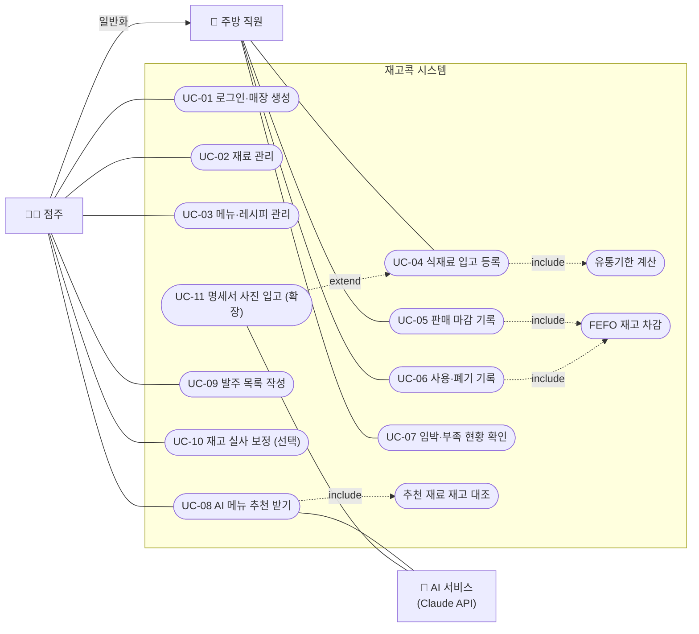

# 요구사항 정의서 (SRS)

> 융합SW모델설계 PBL 10주차 산출물 ② · v0.3 / 2026-10-28 · 작성: 임지섭(요구사항), 성윤우(유스케이스) · 검토: 김형균
> 함께 제출: ① 프로젝트 기획서(`02_프로젝트_기획서.md`), ③ WBS(`04_WBS.md`)·일정표(`05_일정표.md`)

**시스템명:** 재고콕 — 소상공인용 식재료 재고 관리 및 AI 메뉴 추천 시스템 (PBL 후보 과제 6)

---

## 1. 소개

### 1.1 목적
이 문서는 재고콕의 기능·비기능 요구사항, 유스케이스, 비즈니스 규칙, 데이터 요구사항을 정의한다. 설계·구현·테스트·평가의 기준으로 쓴다.

### 1.2 범위
- **필수(MVP):** 과제 안내서 F-01~F-05 — 식재료 입고, 사용·판매 차감, 임박·경과·부족 표시, AI 메뉴 추천, 부족 품목 발주 목록. 이를 위한 재료·메뉴 관리와 로그인·매장 분리
- **선택(확장):** 실사 보정, 주간 폐기 금액, 메뉴 원가, AI 보관일수 추천, AI 명세서 사진 입고
- **제외:** 바코드 스캔, 공공 API 연동, 라벨 날짜 인식, 축산물 이력, POS·결제, 발주 자동 전송, 수요 예측, 알림, 여러 매장·직원별 권한, 네이티브 앱

### 1.3 용어 정의

| 용어 | 정의 |
|---|---|
| 재료 (Ingredient) | 매장에서 관리하는 식재료 품목 (예: 양파) |
| 묶음 (StockLot) | 한 번에 입고된 같은 재료. 입고일·유통기한·잔량·단가를 가진다 |
| FEFO | First Expired, First Out. 유통기한이 빠른 묶음부터 차감 |
| 기본 보관일수 | 재료별로 정한, 입고일로부터 사용 권장 기한까지의 일수 |
| 임박 / 경과 | 유통기한이 오늘부터 3일 이내 / 오늘보다 이전 (BR-05) |
| 최소 재고 · 적정 재고 | 이 수량 미만이면 부족 / 발주 후 채울 목표 수량 (BR-06) |
| 레시피 | 메뉴 1인분에 드는 재료별 소요량 |
| 발주 목록 (PurchaseOrder) | 부족 품목과 권장 발주량을 모은 목록. 거래처에 보낼 텍스트로 복사할 수 있다 |

## 2. 전체 설명

### 2.1 제품 관점
독립형 모바일 웹 서비스. 웹 서버가 데이터베이스(PostgreSQL, Supabase)와 생성형 AI API(Claude)를 사용한다. 외부 공공 API는 사용하지 않는다.

### 2.2 사용자(액터)

| 액터 | 유형 | 특성 |
|---|---|---|
| 점주 | 주 액터 | 매장 운영 책임자. 스마트폰 능숙, PC는 거의 사용 안 함. 주방 직원이 하는 모든 일도 할 수 있다 |
| 주방 직원 | 주 액터 | 점주 매장 계정을 함께 사용. 입고·사용·판매 기록과 재고 확인을 주로 한다 |
| AI 서비스 (Claude API) | 보조 액터 | 메뉴 추천(필수), 명세서 인식·보관일수 추천(확장)을 생성한다 |

### 2.3 제약 사항
- C-01: 모바일 브라우저(iOS Safari, Android Chrome) 최신 2개 버전을 지원한다.
- C-02: 실제 매장·개인 데이터를 쓰지 않고, 생성형 AI로 만든 가상 데이터(재료 30종 이상, 메뉴 15개 이상, 판매 기록 2주 이상)를 쓴다.
- C-03: AI API 키는 서버에서만 사용한다.
- C-04: 개발 기간 5주(2026-10-27 ~ 11-30), 인원 3명, 최종 발표 12/01.

### 2.4 가정
- A-01: 판매 데이터는 사용자가 하루 단위로 직접 입력한다.
- A-02: 시스템이 계산한 유통기한은 매장 기준 권장 기한이며 법적 기한이 아니다.

## 3. 기능 요구사항

> **우선순위:** **P0 = 필수** (5주 안에 반드시 동작) / **P1 = 선택** (필수 완성 후 1순위) / **P2 = 선택** (여유 시)
> **과제 ID:** 주제 안내서 필수 기능 F-01~F-05와의 대응

### 3.1 인증·매장 (AUTH) — 필수 지원

| ID | 요구사항 | 우선순위 | 과제 ID |
|---|---|---|---|
| FR-AUTH-01 | 사용자는 이메일로 로그인할 수 있다. | P0 | 공통 |
| FR-AUTH-02 | 최초 로그인 시 매장 이름을 입력해 매장을 만든다. | P0 | 공통 |
| FR-AUTH-03 | 사용자는 자기 매장의 데이터만 조회·수정할 수 있다. | P0 | 공통 |

### 3.2 재료 관리 (ING) — 필수 지원

| ID | 요구사항 | 우선순위 | 과제 ID |
|---|---|---|---|
| FR-ING-01 | 재료를 등록·수정·비활성화할 수 있다. 필드: 이름, 카테고리, 기본 단위(g/ml/ea), 최소 재고, 적정 재고, 보관 방식(냉장/냉동/실온), 기본 보관일수 | P0 | F-01, F-05 |
| FR-ING-02 | 재료 상세에서 묶음 목록(입고일, 유통기한, 잔량, 단가)을 유통기한 순으로 볼 수 있다. | P0 | F-01 |
| FR-ING-03 | 재료 목록을 이름으로 검색하고 상태(임박/경과/부족)로 필터링할 수 있다. | P1 | F-03 |
| FR-ING-04 | 재료 이름을 입력하면 AI가 보관 방식·기본 보관일수 추천값을 채운다. 사용자가 확정해야 저장된다. | P2 | — |

### 3.3 입고 (STK) — F-01

| ID | 요구사항 | 우선순위 | 과제 ID |
|---|---|---|---|
| FR-STK-01 | 재료를 선택하고 수량, 단위, 입고일(기본 오늘), 단가(선택), 유통기한(선택)을 입력해 입고한다. 한 화면에서 여러 품목을 한 번에 입고할 수 있다. | P0 | F-01 |
| FR-STK-02 | 유통기한을 입력하지 않으면 BR-01에 따라 서버에서 계산하고, 계산 근거("입고일 + 기본 보관일수")를 표시한다. | P0 | F-01 |
| FR-STK-03 | 재료의 기본 단위가 아닌 단위(kg, L, 단, 박스 등)로 입력하면 BR-03에 따라 환산해 저장한다. | P0 | F-01 |
| FR-STK-04 | 입고 시 묶음 1개와 입고 이력 1건이 생성된다. | P0 | F-01 |
| FR-STK-05 | 저장된 발주 목록을 불러와 입고 품목·수량을 미리 채울 수 있다. | P1 | F-01, F-05 |

### 3.4 메뉴·레시피 (MENU) — 필수 지원

| ID | 요구사항 | 우선순위 | 과제 ID |
|---|---|---|---|
| FR-MENU-01 | 메뉴를 등록·수정·비활성화할 수 있다 (이름, 판매가). | P0 | F-02 |
| FR-MENU-02 | 메뉴별 재료와 1인분 소요량(재료 기본 단위)을 등록할 수 있다. | P0 | F-02 |
| FR-MENU-03 | 최근 입고 단가로 메뉴 원가와 원가율을 계산해 표시한다. | P1 | 확장 |

### 3.5 사용·판매 차감 (USE) — F-02

| ID | 요구사항 | 우선순위 | 과제 ID |
|---|---|---|---|
| FR-USE-01 | 날짜별로 메뉴별 판매 수량을 입력할 수 있다 (판매 마감). | P0 | F-02 |
| FR-USE-02 | 판매 저장 시 소요량 × 판매 수량만큼 재료를 FEFO로 차감한다 (BR-02). | P0 | F-02 |
| FR-USE-03 | 메뉴와 상관없는 재료 사용(직원 식사, 시식 등)을 재료·수량·메모로 기록하면 FEFO로 차감한다. | P0 | F-02 |
| FR-USE-04 | 묶음 단위로 폐기 수량과 사유(기한 경과/변질/실수/기타)를 기록하면 해당 묶음에서 차감한다. | P0 | F-02 |
| FR-USE-05 | 재고가 부족하면 경고하고, 부족분은 차감하지 않고 부족 기록으로 남긴다. 재고는 음수가 되지 않는다. | P0 | F-02 |
| FR-USE-06 | 같은 날짜의 판매를 다시 입력하면 기존 차감을 되돌리고 다시 차감한다. | P1 | F-02 |
| FR-USE-07 | 실사 수량을 입력해 시스템 재고를 보정하고 조정 이력을 남긴다. | P1 | 확장 |

### 3.6 임박·부족 현황 (DASH) — F-03

| ID | 요구사항 | 우선순위 | 과제 ID |
|---|---|---|---|
| FR-DASH-01 | 첫 화면(대시보드)에 임박 묶음(D-3 이내)을 유통기한 순으로 "D-2"와 날짜로 표시한다. | P0 | F-03 |
| FR-DASH-02 | 기한이 지난 묶음을 따로 표시하고, 바로 폐기 기록(FR-USE-04)으로 이동하는 버튼을 제공한다. | P0 | F-03 |
| FR-DASH-03 | 사용 가능 재고가 최소 재고 미만인 재료를 표시한다 (BR-05). | P0 | F-03 |
| FR-DASH-04 | AI 메뉴 추천과 발주 목록으로 가는 바로가기를 제공한다. | P0 | F-04, F-05 |
| FR-DASH-05 | 이번 주 폐기 금액과 지난주 대비 증감을 표시한다. | P1 | 확장 |

### 3.7 AI 메뉴 추천 (REC) — F-04

| ID | 요구사항 | 우선순위 | 과제 ID |
|---|---|---|---|
| FR-REC-01 | 임박 묶음, 현재 재고, 메뉴·레시피, 최근 7일 판매량을 입력으로 추천을 만든다. | P0 | F-04 |
| FR-REC-02 | 추천은 ① 우선 판매할 기존 메뉴(이유, 소진되는 임박 재료·수량) ② 신규 특선 아이디어(필요 재료·사용량, 조리 순서)로 구성한다. | P0 | F-04 |
| FR-REC-03 | 서버는 추천의 모든 재료를 재고 DB와 대조해 재료마다 **보유 / 부족 / 미등록**을 표시한다. 보유 수량은 AI가 아닌 DB 값을 쓴다. | P0 | F-04 |
| FR-REC-04 | 존재하지 않는 기존 메뉴를 추천하거나 출력 형식이 맞지 않으면 그 항목을 제외하고, 제외 건수를 기록한다. | P0 | F-04 |
| FR-REC-05 | 추천 결과에 "AI 추천" 표시와 "재고 대조 결과를 확인하세요" 안내를 함께 보여 준다. | P0 | F-04 |
| FR-REC-06 | 추천 기준(유통기한 우선 / 원가 우선 / 인기 우선)을 선택할 수 있다. 기본값은 유통기한 우선이다. | P1 | F-04 |
| FR-REC-07 | 신규 특선 아이디어를 사용자가 검토·수정한 뒤 메뉴·레시피로 등록할 수 있다. | P1 | F-04 |
| FR-REC-08 | 추천 입력, 결과, 검증 결과(제외·부족 건수), 수용 여부를 저장한다. | P1 | 검증 |

### 3.8 발주 목록 (ORD) — F-05

| ID | 요구사항 | 우선순위 | 과제 ID |
|---|---|---|---|
| FR-ORD-01 | 부족 재료(BR-05)를 모아 재료별 권장 발주량(BR-06)을 계산한 발주 목록 초안을 만든다. | P0 | F-05 |
| FR-ORD-02 | 사용자는 품목을 추가·삭제하고 발주량을 수정할 수 있다. | P0 | F-05 |
| FR-ORD-03 | 발주 목록을 저장하고, 날짜별로 다시 조회할 수 있다. 상태는 작성중 / 발주완료 / 입고완료다. | P0 | F-05 |
| FR-ORD-04 | 발주 목록을 "품목 수량단위" 형식 텍스트로 클립보드에 복사한다 (거래처 문자 전송용). | P0 | F-05 |

### 3.9 명세서 사진 입고 (RCP) — 확장

| ID | 요구사항 | 우선순위 | 과제 ID |
|---|---|---|---|
| FR-RCP-01 | 거래명세서를 촬영·업로드하면 AI가 품목명·수량·단위·단가와 연결할 재료 후보를 추출한다. | P2 | 확장 |
| FR-RCP-02 | 추출 결과는 확인 화면에서 수정할 수 있고, 사용자가 확정해야 FR-STK-04와 같은 방식으로 입고된다. | P2 | 확장 |
| FR-RCP-03 | 인식 실패 시 수동 입고 화면(FR-STK-01)으로 전환한다. | P2 | 확장 |

## 4. 유스케이스

### 4.1 유스케이스 다이어그램

UML 원본은 `docs/diagrams/usecase.puml`(PlantUML)이며, 아래는 같은 내용을 Mermaid로 그린 것이다. 점선 화살표는 «include»/«extend», 액터 사이 실선 화살표는 일반화다.



### 4.2 유스케이스 목록

| ID | 유스케이스 | 주 액터 | 관련 요구사항 | 우선순위 |
|---|---|---|---|---|
| UC-01 | 로그인·매장 생성 | 점주 | FR-AUTH-01~03 | P0 |
| UC-02 | 재료 관리 | 점주 | FR-ING-01~04 | P0 |
| UC-03 | 메뉴·레시피 관리 | 점주 | FR-MENU-01~03 | P0 |
| UC-04 | 식재료 입고 등록 | 주방 직원 | FR-STK-01~05, BR-01, BR-03 | P0 |
| UC-05 | 판매 마감 기록 | 주방 직원 | FR-USE-01, 02, 05, 06, BR-02 | P0 |
| UC-06 | 사용·폐기 기록 | 주방 직원 | FR-USE-03~05, BR-02 | P0 |
| UC-07 | 임박·부족 현황 확인 | 주방 직원 | FR-DASH-01~05, BR-05 | P0 |
| UC-08 | AI 메뉴 추천 받기 | 점주, AI 서비스 | FR-REC-01~08, BR-04 | P0 |
| UC-09 | 발주 목록 작성 | 점주 | FR-ORD-01~04, BR-06 | P0 |
| UC-10 | 재고 실사 보정 | 점주 | FR-USE-07 | P1 |
| UC-11 | 명세서 사진 입고 | 주방 직원, AI 서비스 | FR-RCP-01~03, BR-04 | P2 |

점주는 주방 직원을 일반화한 액터이므로 UC-04~07도 수행할 수 있다.

### 4.3 핵심 유스케이스 명세

**UC-04 식재료 입고 등록**

| 항목 | 내용 |
|---|---|
| 액터 | 주방 직원 (점주 포함) |
| 사전 조건 | 로그인 상태, 입고할 재료가 등록되어 있음 |
| 기본 흐름 | 1. 입고 화면을 연다. 2. 재료를 검색해 선택하고 수량·단위·단가를 입력한다. 3. 유통기한을 입력하거나 비워 둔다. 4. 품목을 더 추가한다. 5. "입고"를 누른다. 6. 시스템이 단위를 환산하고(BR-03) 비어 있는 유통기한을 계산해(BR-01) 묶음과 입고 이력을 저장한다. 7. 입고 결과와 계산된 유통기한을 보여 준다. |
| 대안 흐름 | 2a. 재료가 없으면 그 자리에서 새 재료를 등록하고 돌아온다(UC-02). 2b. 저장된 발주 목록을 불러와 품목·수량을 채운다(FR-STK-05). |
| 예외 흐름 | 6a. 수량 ≤ 0이거나 유통기한이 입고일보다 이르면 저장하지 않고 해당 행을 표시한다. 6b. 환산 계수가 없는 단위면 환산 계수 입력을 요청한다. |
| 사후 조건 | 재료의 재고가 늘고 묶음이 유통기한 순 목록에 나타난다. |

**UC-05 판매 마감 기록**

| 항목 | 내용 |
|---|---|
| 액터 | 주방 직원 (점주 포함) |
| 사전 조건 | 메뉴와 레시피가 등록되어 있음 |
| 기본 흐름 | 1. 판매 마감 화면에서 날짜(기본 오늘)를 확인한다. 2. 메뉴별 판매 수량을 입력한다. 3. "마감"을 누른다. 4. 시스템이 재료별 필요량(소요량 × 수량)을 합산하고 FEFO로 묶음을 차감하며(BR-02) 이력을 남긴다. 5. 차감 결과와 새로 생긴 부족 재료를 보여 준다. |
| 대안 흐름 | 1a. 이미 마감한 날짜면 기존 수량을 불러오고, 저장 시 이전 차감을 되돌린 뒤 다시 차감한다(FR-USE-06). |
| 예외 흐름 | 4a. 재고가 모자라면 가능한 만큼만 차감하고 부족분을 기록·경고한다(FR-USE-05). 4b. 저장 중 다른 기기에서 재고가 바뀌면 전체를 취소하고 다시 계산한다. |
| 사후 조건 | 모든 차감이 함께 반영되거나 하나도 반영되지 않는다 (NFR-07). |

**UC-08 AI 메뉴 추천 받기**

| 항목 | 내용 |
|---|---|
| 액터 | 점주, AI 서비스 |
| 사전 조건 | 메뉴·레시피와 재고가 있음 |
| 기본 흐름 | 1. 추천 화면에서 추천 기준을 고르고 "추천 받기"를 누른다. 2. 시스템이 임박 재료·재고·메뉴·판매량을 모아 AI에 요청한다. 3. AI가 기존 메뉴 추천과 신규 특선 아이디어를 돌려준다. 4. 시스템이 출력 형식을 검증하고, 모든 재료를 재고 DB와 대조해 보유/부족/미등록을 붙인다(BR-04). 5. "AI 추천" 표시와 함께 결과를 보여 준다. |
| 대안 흐름 | 5a. 점주가 신규 특선을 수정해 메뉴로 등록한다(FR-REC-07). |
| 예외 흐름 | 3a. AI 응답이 형식에 맞지 않으면 1회 다시 요청하고, 또 실패하면 "추천을 만들지 못했어요"와 함께 임박 재료가 들어간 기존 메뉴를 규칙 기반으로 보여 준다. 4a. 없는 메뉴를 추천한 항목은 제외한다. |
| 사후 조건 | 추천과 검증 결과가 저장된다. 사용자가 등록하기 전에는 메뉴·재고가 바뀌지 않는다. |

**UC-09 발주 목록 작성**

| 항목 | 내용 |
|---|---|
| 액터 | 점주 |
| 사전 조건 | 재료에 최소 재고가 설정되어 있음 |
| 기본 흐름 | 1. 발주 목록 화면을 연다. 2. 시스템이 부족 재료와 권장 발주량(BR-06)을 채운 초안을 보여 준다. 3. 점주가 수량을 고치거나 품목을 더한다. 4. "저장"을 누르면 작성중 상태로 저장된다. 5. "복사"로 텍스트를 복사해 거래처에 보내고 "발주완료"로 바꾼다. |
| 대안 흐름 | 2a. 부족 재료가 없으면 "부족한 재료가 없어요"를 보여 주고 직접 품목을 추가할 수 있다. |
| 예외 흐름 | 3a. 발주량이 0 이하인 품목은 저장 시 제외한다. |
| 사후 조건 | 발주 목록이 저장되고, 입고 화면에서 불러올 수 있다(FR-STK-05). 그 목록으로 입고하면 입고완료가 된다. |

## 5. 비즈니스 규칙

### BR-01 유통기한 결정
```text
1. 사용자가 입력한 유통기한          → expires_at = 입력값                    (source=manual)
2. 입력 없음                         → expires_at = 입고일 + 기본 보관일수    (source=default)
-  기한 추적 제외 재료(소금, 설탕 등) → expires_at = null
```
- 날짜 계산은 서버 코드에서만 한다. 날짜 기준은 한국 시간(KST)이다.
- 확장 기능(명세서 인식)으로 읽은 날짜도 1번(사용자 확인 후 입력값)으로 취급한다.

### BR-02 FEFO 차감
- 대상: 해당 재료의 잔량 > 0 묶음
- 순서: 유통기한 오름차순(null은 마지막) → 입고일 오름차순
- 앞 묶음부터 잔량을 차감하고 묶음마다 차감 이력을 남긴다.
- 여러 재료의 차감은 하나의 트랜잭션으로 처리한다.

### BR-03 단위 환산
- 재고는 재료의 기본 단위(g/ml/ea)로 저장한다.
- 고정 환산: kg→g ×1000, L→ml ×1000. 그 외(단, 박스, 판 등)는 재료별로 사용자가 입력한 환산 계수를 쓴다.

### BR-04 AI 결과 반영 원칙
- AI가 만든 데이터는 사용자 확인 없이 재고·재료·메뉴에 반영하지 않는다.
- 수량, 원가, 유통기한, 보유 여부는 AI 출력이 아니라 서버 코드와 DB 값으로 정한다.
- AI 생성 결과에는 항상 "AI 추천" 표시를 붙인다.

### BR-05 임박·경과·부족 판정
- 경과: 유통기한 < 오늘 / 임박: 오늘 ≤ 유통기한 ≤ 오늘 + 3일
- 사용 가능 재고 = 경과하지 않은 묶음의 잔량 합
- 부족: 사용 가능 재고 < 최소 재고 (최소 재고가 0이면 판정하지 않음)

### BR-06 권장 발주량
- 권장 발주량 = 적정 재고 − 사용 가능 재고 (0 이하면 목록에서 제외)
- 적정 재고를 입력하지 않았으면 최소 재고 × 2를 쓴다.
- 계산 결과는 재료 기본 단위로 표시하고 소수점은 올림한다.

## 6. 비기능 요구사항

과제 6의 핵심 품질 속성은 **정확성(재고 수량)** 과 **사용성**이다. 두 속성의 목표·검증 방법은 11주차 시스템 설계서에서 구체화한다.

| ID | 품질 속성 | 요구사항 | 검증 방법 |
|---|---|---|---|
| NFR-01 | **정확성** | 차감·환산·기한·발주량 계산 결과가 손계산과 100% 일치한다. | 계산 함수 단위 테스트 (정상·경계·예외) |
| NFR-02 | **정확성** | 재고는 음수가 되지 않으며, 동시에 판매를 입력해도 재고가 어긋나지 않는다. | 동시 차감 테스트 |
| NFR-03 | **정확성** | AI 추천의 재료 보유/부족 표시가 재고 DB와 100% 일치한다. | 가상 데이터 20회 추천 결과 대조 |
| NFR-04 | **사용성** | 입고 1품목 등록은 화면 진입 후 30초 이내, 판매 마감(메뉴 10개)은 2분 이내에 끝낼 수 있다. | 팀원 외 사용자 3명 과업 시간 측정 |
| NFR-05 | **사용성** | 모바일(360px 이상) 한 손 조작. 주요 버튼 높이 44px 이상, 유통기한은 "D-2"와 날짜를 함께 색으로 구분해 표시 | 375×812 화면 점검 |
| NFR-06 | 성능 | 일반 화면 응답 1초 이내, AI 추천 15초 이내(진행 상태 표시) | 측정 기록 |
| NFR-07 | 신뢰성 | 재고 변경은 트랜잭션으로 처리해 일부만 반영되지 않는다. | DB 테스트 |
| NFR-08 | 신뢰성 | AI API가 실패해도 재고 관리 기능은 계속 쓸 수 있고, 실패 안내를 보여 준다. | AI 장애 모의 테스트 |
| NFR-09 | 보안 | 매장 단위로 데이터를 격리해 다른 매장 데이터를 조회할 수 없다. | 다른 계정 접근 테스트 |
| NFR-10 | 보안 | API 키는 서버 환경변수로만 관리하고 클라이언트에 노출하지 않는다. | 빌드 결과물 점검 |
| NFR-11 | 유지보수성 | 재고 계산(FEFO, 기한, 단위, 발주량)은 화면·DB와 분리된 함수로 두고 단위 테스트 커버리지 80% 이상 | 커버리지 리포트 |
| NFR-12 | 비용 | AI 호출은 매장별 하루 한도를 두고, 자동 테스트에서는 고정 응답을 쓴다. | 설정 점검 |

## 7. 데이터 요구사항

| ID | 요구사항 |
|---|---|
| DR-01 | 재고는 재료 단위가 아니라 **입고 묶음 단위**로 저장하고, 묶음마다 입고일·유통기한·유통기한 출처·잔량·단가를 가진다. |
| DR-02 | 모든 재고 변화(입고·판매·사용·폐기·보정)는 이력으로 남기며, 이력은 수정·삭제하지 않는다. |
| DR-03 | 모든 데이터는 매장 단위로 격리한다. |

**주요 엔티티(ERD 설계 출발점):** Store, Ingredient, StockLot, StockMovement(이력), Menu, Recipe(메뉴-재료 소요량), DailySales, PurchaseOrder, PurchaseOrderItem, Recommendation. 속성·관계는 11주차 시스템 설계서의 ERD에서 확정한다.

## 8. 요구사항 추적표

| 과제 ID | 기능 | 유스케이스 | 요구사항 | WBS |
|---|---|---|---|---|
| F-01 | 식재료 입고 등록 | UC-04 | FR-STK-01~05, FR-ING-01~02, BR-01, BR-03 | 3.3, 3.5 |
| F-02 | 사용·판매 차감 | UC-05, UC-06 | FR-USE-01~06, FR-MENU-01~02, BR-02 | 3.4, 3.6, 3.7 |
| F-03 | 임박·경과·부족 표시 | UC-07 | FR-DASH-01~04, FR-ING-03, BR-05 | 4.1 |
| F-04 | AI 메뉴·레시피 추천 | UC-08 | FR-REC-01~08, BR-04 | 4.2 |
| F-05 | 부족 품목 발주 목록 | UC-09 | FR-ORD-01~04, BR-06 | 4.3 |
| 공통 | 로그인·매장 | UC-01 | FR-AUTH-01~03 | 2.4 |
| 공통 | 재료·메뉴 관리 | UC-02, UC-03 | FR-ING-01~03, FR-MENU-01~02 | 3.1, 3.2 |
| 확장 | 실사 보정·폐기 금액·원가 | UC-10 | FR-USE-07, FR-DASH-05, FR-MENU-03 | 4.5 |
| 확장 | AI 보관일수 추천 | UC-02 | FR-ING-04 | 4.6 |
| 확장 | 명세서 사진 입고 | UC-11 | FR-RCP-01~03 | 4.7 |

## 9. 변경 이력

| 버전 | 날짜 | 내용 |
|---|---|---|
| v0.2 | 2026-10-27 | 초안 |
| v0.3 | 2026-10-28 | 10주차 피드백 반영: 유스케이스 다이어그램·명세 추가, 과제 F-01~F-05 기준으로 범위 축소(바코드·공공 API·라벨·축산물 이력 제외, 명세서 인식은 확장), 사용 기록·폐기 기록·발주 목록(F-05) 추가, 비기능 요구사항에 검증 방법 추가 |
