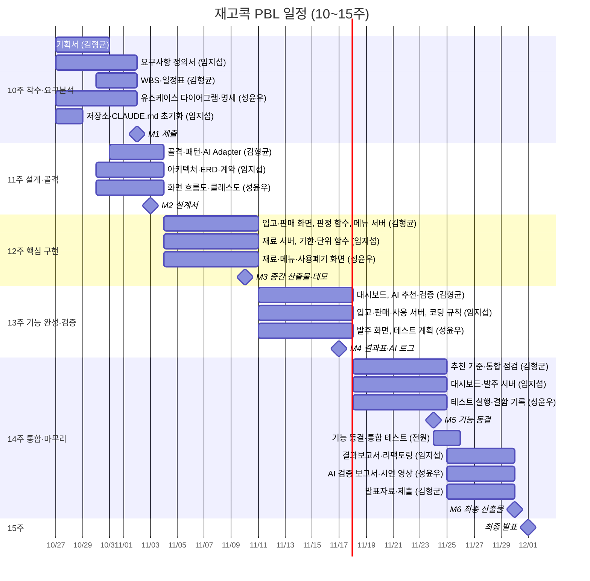

# 일정표

> 융합SW모델설계 PBL 10주차 산출물 ③-2 · v0.4 / 2026-11-10 (개정 운영계획서 마감 반영)
> 함께 제출: ① 프로젝트 기획서, ② 요구사항 정의서(`03_SRS.md`), ③-1 WBS(`04_WBS.md`)

**프로젝트:** 재고콕 (PBL 후보 과제 6)
**기간:** 2026-10-27(화, 10주차) ~ 2026-12-01(화, 15주차 최종 발표)
**팀:** 김형균(팀장·핵심 화면·AI 계층), 임지섭(설계·문서·백엔드·계산), 성윤우(검증·관리 화면·테스트)

> 작업 ID와 공수는 ③-1 WBS를 따른다.

---

## 1. 운영 방식 (1주 = 1스프린트)

수업은 매주 화요일 1~3교시이고, 개정 운영계획서(2026-11-02)에 따라 주간 산출물은 **수업 당일(화) 20:00**까지 제출한다(최종 산출물만 11/30(월) 20:00). 따라서 한 스프린트는 **수요일 ~ 다음 화요일 수업·20:00 제출**이다. 화요일 수업에서는 스탠드업과 교수 피드백을 반영해 그 주 산출물을 마무리한다.

> 10주차는 개정 전 일정(화 착수 ~ 다음 월 제출)으로 진행했고, 11주차 산출물 ④는 바뀐 마감(11/03)에 맞춰 10주차 작업과 겹쳐 준비했다.

| 시점 | 활동 | 진행 |
|---|---|---|
| 화 1교시 중반 (10분) | 스탠드업: 지난주 한 일 / 이번 주 할 일 / 막힌 점 (1인 2~3분) | 김형균, 진행 일지에 바로 기록 |
| 화 1~3교시 | 스프린트 수행, 교수 순회 피드백 반영 | 전원 |
| 화 3교시 종료 10분 전 | 회고: 잘된 점·개선할 점, AI 활용 로그 정리 | 전원 |
| 화 20:00 | 주간 산출물 제출 (진행 일지 + 해당 주차 산출물) | 김형균 |
| 금 (온라인 10분) | 중간 점검: 다음 화요일 제출물 진행률, 막힌 작업 재분배 | 김형균 |

## 2. 주차별 계획

| 주차 | 스프린트 기간 | 목표 | 주요 작업 (WBS) | 제출물 · 마감 |
|---|---|---|---|---|
| **10주** | 10/27(화) ~ 11/02(월) (개정 전) | 착수·요구분석 | 2.1 기획서, 2.2 요구사항 정의서·유스케이스, 2.3 WBS·일정표, 1.1 저장소·`CLAUDE.md` | ① 기획서 ② 요구사항 정의서 초안 ③ WBS·일정표 — 개정 기준 10/27(화) 20:00 (개정 전 11/02 기준으로 작성) |
| **11주** | ~ 11/03(화) | 설계 + 골격 | 2.5 아키텍처·품질 속성, 2.6a 패턴·SOLID, 2.6b 클래스 다이어그램, 2.7 ERD·마이그레이션, **2.10 인터페이스 계약(11/05)**, 2.8 화면 흐름도, 2.4 골격·로그인·배포, 2.9 가상 데이터, 3.1a 재료 화면, 3.5a 기한·단위 함수, 3.10a AI Adapter | ④ 시스템 설계서 초안 — **11/03(화) 20:00** (2.10 계약·3.1a·3.5a는 11/05까지) |
| **12주** | 11/04(수) ~ 11/10(화) | 핵심 구현·중간 점검 | **11/10 3교시 중간 데모(5분)**, 3.1~3.7 재료·메뉴·입고·FEFO·판매·사용·폐기(화면 a·서버 b 병렬), 3.5b 판정·발주량 함수, 3.8 코딩 규칙, 3.9 테스트 계획, 3.10b 추천 프롬프트 초안 | ⑤ 중간 산출물(①~④ 수정본 + 구현 초안 + 테스트 계획) — **11/10(화) 20:00** |
| **13주** | 11/11(수) ~ 11/17(화) | 기능 완성·검증 | 12주에 남은 서버 작업(3.3b·3.4·3.6b·3.7b) 먼저, 4.1a 대시보드, 4.2 AI 추천·검증, 4.3a 발주 화면, 4.4 테스트 실행·결함 기록 | ⑥ 테스트 케이스·결과표 ⑦ AI 활용 로그(중간) — **11/17(화) 20:00** |
| **14주** | 11/18(수) ~ 11/24(화), 정리 ~ 11/30(월) | 통합·마무리 | 4.1b 대시보드·4.3b 발주 서버(11/20까지), **11/24 기능 동결**, 5.1 통합 테스트, 5.2 리팩토링, 5.3 결과보고서, 5.4 AI 검증 보고서, 5.5 발표자료, 5.6 시연 영상, **11/24 3교시 팀 간 리허설** | ⑧ 최종 산출물 일체 — **11/30(월) 20:00** |
| **15주** | 12/01(화) | 최종 발표 | 발표 8분 + 시연 4분 + 질의응답 3분, 동료 평가 | 발표·시연 |

## 3. 마일스톤

운영계획서 6.3절 주차별 완료 기준에 맞췄다.

| 마일스톤 | 날짜 | 완료 기준 |
|---|---|---|
| M1 요구분석 완료 | 10/27 (화), 개정 전 기준 11/02 | 주제 확정, 필수 기능 요구사항에 ID·우선순위 부여, 유스케이스 다이어그램, 팀원별 역할·5주 일정 합의 |
| M2 설계 완료 | 11/03 (화) | 아키텍처 스타일 근거, 클래스 다이어그램(관계 6종 구분), 디자인 패턴 2개와 이유, ERD, 로그인 후 빈 대시보드 배포 |
| M3 중간 점검 | 11/10 (화) | **핵심 기능 2개 이상 DB 연동 동작** (11/10 실제: 재료·메뉴 관리. 입고·판매 차감 서버는 13주 첫 작업), 계산 함수 테스트 통과, 중간 점검 피드백 목록 정리 |
| M4 필수 기능 완료 | 11/17 (화) | **F-01~F-05 모두 동작**, AI 추천이 재고 대조 검증과 함께 동작, 테스트 실행 결과 기록. 미달 항목(대시보드·발주 서버 등)은 11/24 기능 동결 전까지 우선 처리 (운영계획서 6.3) |
| M5 기능 동결·제출 | 11/24 (화) 동결, 11/30 (월) 20:00 제출 | 전체 시나리오 끊김 없이 시연 가능, 최종 산출물 전부 제출 |
| M6 최종 발표 | 12/01 (화) | 발표·시연 |

## 4. 간트 차트

[크게 보기 (HTML)](diagrams/schedule-gantt.html)

Mermaid 원본

## 5. 점검 기준과 미달 시 조치

| 시점 | 점검 항목 | 미달 시 조치 |
|---|---|---|
| 11/06 (금) | 마이그레이션·로그인 배포, 계산 함수 테스트 작성 시작 | 11/10 데모를 재료·입고 화면 시연으로 축소 |
| 11/13 (금) | F-01 입고, F-02 판매 차감 DB 연동 (12주에 못 끝낸 3.3b·3.6b) | 주말까지 전원이 F-02 우선 처리, 확장 기능 착수 금지 |
| 11/14 (금) | F-03~F-05 화면 동작, AI 추천 검증 시작 | 컷라인(③-1 WBS 5장) 1~3번 제외 확정, 추천은 기존 메뉴 추천만으로 축소 |
| 11/20 (금) | 대시보드·발주 서버 연동 | 대시보드를 재료 목록 조회 재사용으로 축소 |
| 11/24 (화) | 기능 동결 | 이후에는 버그 수정만 한다 |
