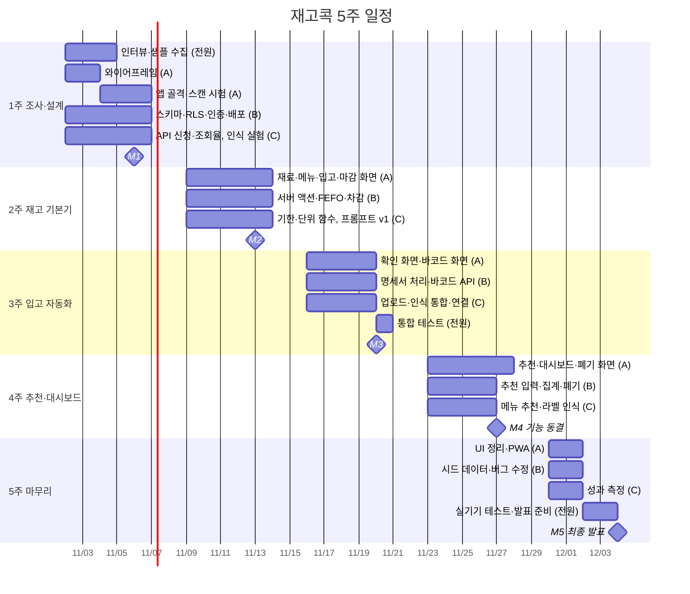

# 일정표

**프로젝트:** 재고콕
**기간(예정):** 2026-11-02(월) ~ 2026-12-04(금), 5주
**담당:** A 프론트엔드 / B 백엔드·데이터 / C AI·도메인 계산

> 작업 ID와 공수는 `04_WBS.md`, 작업별 완료 조건은 `11_TASK.md`를 따른다. 시작일이 다르면 날짜만 옮긴다.

---

## 1. 마일스톤

| 마일스톤 | 날짜 | 완료 기준 |
|---|---|---|
| M1 설계 완료 | 11/06 (금) | 로그인 후 빈 대시보드 배포, 스키마 확정, 바코드 조회율 측정 |
| M2 재고 기본기 | 11/13 (금) | 수동 입고·판매 차감 동작, 계산 함수 테스트 통과 |
| M3 입고 자동화 | 11/20 (금) | 명세서 사진·바코드 두 경로로 입고 완료 |
| M4 기능 동결 | 11/27 (금) | 데모 시나리오(`01_PRD.md` 7장) 전체 동작 |
| M5 최종 발표 | 12/04 (금) | 발표·시연 |

## 2. 간트 차트

## 3. 주차별 핵심 목표

| 주차 | 기간 | 꼭 끝낼 것 | 1일차에 할 일 |
|---|---|---|---|
| 1 | 11/02 ~ 11/06 | 인터뷰, 스키마, 배포, 바코드 조회율 | **식약처 API 인증키 신청**, Claude API 사용 한도 설정 |
| 2 | 11/09 ~ 11/13 | 수동 입고 → 판매 차감 흐름 | 계산 함수(기한·FEFO·단위) 테스트부터 작성 |
| 3 | 11/16 ~ 11/20 | 사진·바코드 입고 | 확인 화면과 인식 API의 입출력 형식 합의 |
| 4 | 11/23 ~ 11/27 | 추천, 대시보드, 기능 동결 | 3주차 미완료 작업 정리 |
| 5 | 11/30 ~ 12/04 | 측정, 시연 데이터, 발표 | 시연 시나리오 확정 |

## 4. 정기 회의

| 회의 | 일정 | 내용 |
|---|---|---|
| 주간 계획 | 매주 월요일 | 이번 주 작업 분배, 리스크 확인 |
| 데일리 체크 | 매일 (메신저 3줄) | 어제 한 일 / 오늘 할 일 / 막힌 점 |
| 주간 점검 | 매주 금요일 | 마일스톤 점검, 데모, 다음 주 조정 |

## 5. 주간 점검 기준

| 시점 | 점검 항목 | 미달 시 조치 |
|---|---|---|
| 1주차 금 | API 키 발급, 바코드 조회율 | 키 미발급 → 목 데이터로 개발 / 조회율 낮음 → 컷라인 4번 적용 검토 |
| 2주차 금 | 계산 함수 테스트 통과 | 3주차 월요일 오전까지 B·C 공동 해결 |
| 3주차 금 | 명세서 입고 전체 흐름 | 컷라인 1~3번 제외 확정 |
| 4주차 금 | 데모 시나리오 동작 | 추천을 "기존 메뉴 우선 판매"로만 축소 |

컷라인 목록은 `04_WBS.md` 4장 참고.
