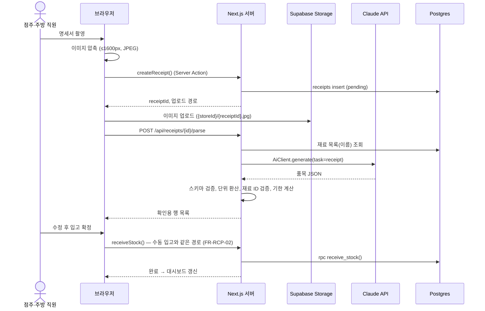
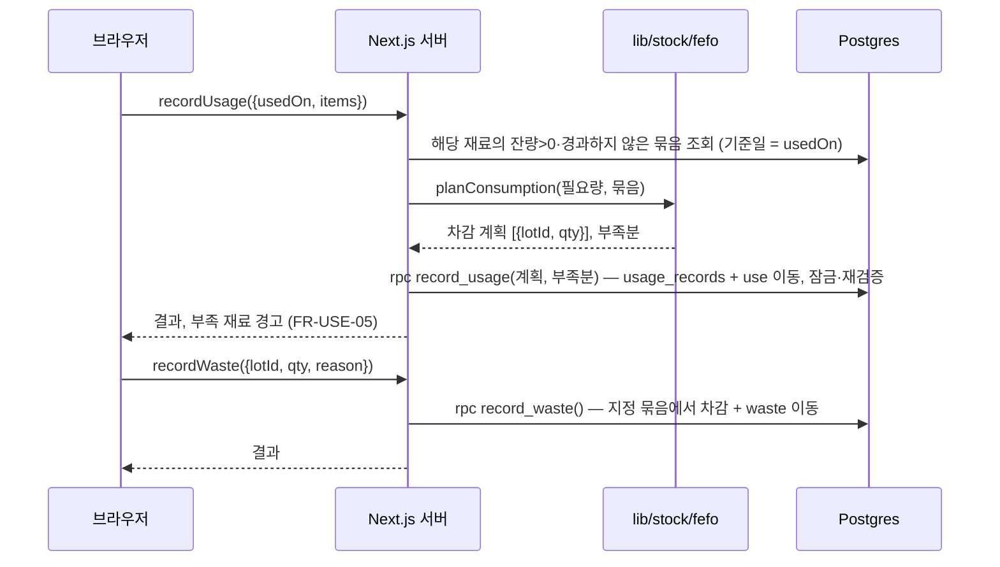
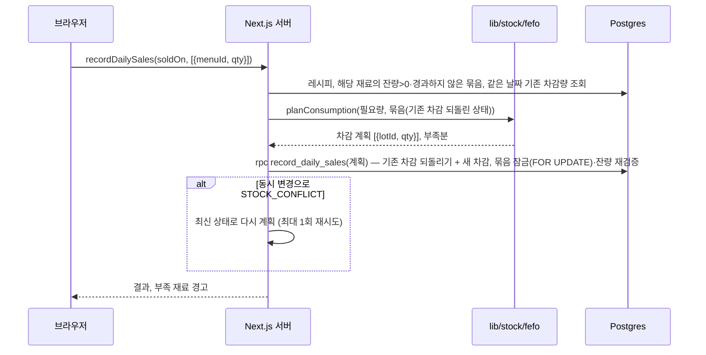
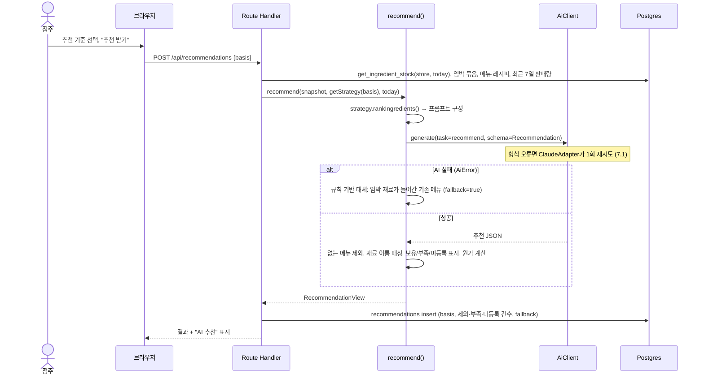
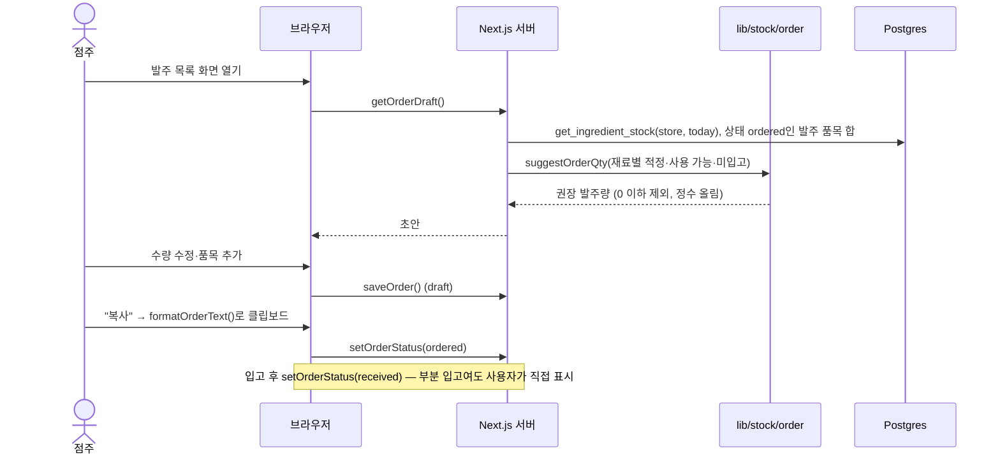
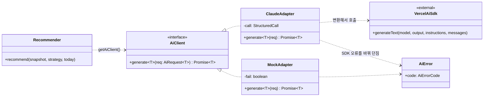
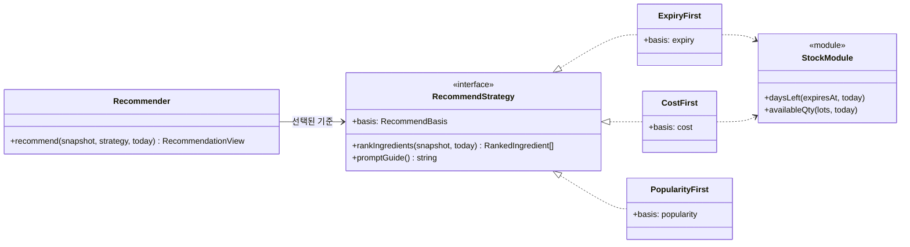
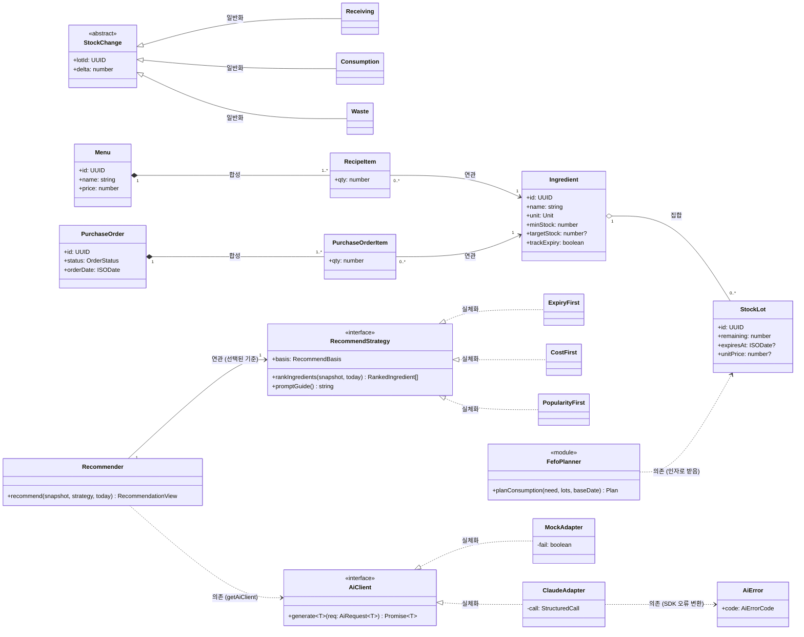

# 아키텍처 설계서

**시스템:** 재고콕 — 소상공인용 식자재 재고 관리 및 AI 메뉴 추천 시스템
**버전:** v0.3 / 2026-11-03 (SRS v0.4 범위로 개정, 시스템 설계서 절 14~18장 초안 추가)
**관련 문서:** `03_SRS.md`, `08_API_SPEC.md`, `07_DB.md`, `09_DESIGN.md`

> 11주차 ④ 시스템 설계서의 아키텍처 스타일(14장), 품질 속성(15장), 4+1 관점(16장), 클래스 다이어그램(17장), SOLID 점검(18장)은 이 문서에 있다. 14·15장은 작업 2.5(임지섭), 16~18장은 2.6a(김형균)·2.6b(성윤우)에서 확정한다.

---

## 1. 설계 원칙

| 원칙 | 내용 |
|---|---|
| **AI는 제안만 한다** | AI 출력은 사용자 확인 없이 재고·재료·메뉴에 반영하지 않는다 (SRS BR-04) |
| **계산은 코드가 한다** | 날짜 계산, 단위 환산, FEFO 차감, 임박·부족 판정, 발주량 계산은 AI가 아니라 순수 함수가 한다 |
| **재고 변경은 원자적으로** | 재고를 바꾸는 작업은 Postgres 함수(RPC) 하나로 처리해 부분 반영을 막는다 |
| **이력은 지우지 않는다** | `stock_movements`는 추가만 한다. 되돌리기는 반대 방향 이력을 추가한다 |
| **비밀은 서버에만** | Claude API 키는 서버 환경변수로만 쓴다 |
| **AI 의존은 감싼다** | AI SDK는 `lib/ai/adapters` 뒤에 숨겨 모델 교체·목(mock) 처리를 한 곳에서 한다 (7.1) |

## 2. 시스템 구성도

```text
┌───────────────────────────── 휴대폰 브라우저 ─────────────────────────────┐
│  Next.js 클라이언트 컴포넌트 (shadcn/ui, Tailwind)                          │
│  - 다품목 입고·판매 마감·사용 기록 폼   - 발주 목록 편집·복사                   │
│  - 기한 미리보기 (lib/stock 순수 함수 공유)                                   │
│  - (확장) 명세서 사진 압축 후 업로드                                          │
└───────────────┬───────────────────────────────────────────────────────────┘
                │ HTTPS (Server Actions / Route Handlers / (확장) Storage 업로드)
┌───────────────▼──────────────── Vercel (Next.js 서버) ────────────────────┐
│  app/ (RSC 페이지)  ──▶  lib/queries (조회)                                 │
│  actions/ (Server Actions: 변경)                                           │
│  app/api/ (Route Handlers: AI 추천, maxDuration 60s)                        │
│        │                         │                                          │
│        ▼                         ▼                                          │
│  lib/stock (도메인 순수 함수)   lib/ai (Adapter·Strategy·스키마·후처리 검증)     │
└────────┬───────────────────────────────┬──────────────────────────────────┘
         ▼                               ▼
 ┌──────────────┐               ┌─────────────────┐
 │  Supabase     │               │  Claude API      │
 │  Postgres+RLS │               │  Sonnet 5.5      │
 │  RPC 함수     │               │  Haiku 5.5(확장) │
 │  Auth         │               └─────────────────┘
 │  Storage(확장)│
 └──────────────┘
```

## 3. 계층 구조

| 계층 | 위치 | 책임 | 의존 가능 대상 |
|---|---|---|---|
| 표현 (UI) | `src/app`, `src/components` | 화면, 폼, 상태 표시 | actions, queries, lib/stock(순수 함수) |
| 진입점 (애플리케이션) | `src/actions`, `src/app/api` | 인증 확인, 입력 검증(Zod), 유스케이스 조합, 결과 변환 | lib/* |
| 도메인 | `src/lib/stock` | 기한 계산, 단위 환산, FEFO 계획, 임박·경과·부족 판정, 권장 발주량, (확장) 원가 | **없음 (순수 함수)** |
| AI | `src/lib/ai` | `AiClient` Adapter, 추천 기준 Strategy, 프롬프트, 출력 스키마, 후처리 검증 | lib/stock (검증용) |
| 데이터 | `src/lib/supabase`, `src/lib/queries`, `supabase/migrations` | 클라이언트 생성, 조회 쿼리, 스키마·RLS·RPC | - |

**규칙:** 도메인 계층(`lib/stock`)은 DB·네트워크·`Date.now()`에 의존하지 않는다. 오늘 날짜도 인자로 받는다. 그래야 단위 테스트가 쉽다.

## 4. 폴더 구조

파일별 담당자(코드 소유권)는 `04_WBS.md` 3.1을 따른다.

```text
src/
  app/
    (auth)/login/  (auth)/onboarding/
    (main)/
      page.tsx                     # 대시보드
      ingredients/  [id]/          # 재료 목록·상세·등록
      menus/  [id]/                # 메뉴·레시피
      receive/                     # 다품목 입고 (확장: receipt/[id]/)
      sales/                       # 판매 마감
      waste/                       # 사용·폐기 기록
      orders/  [id]/               # 발주 목록
      recommend/                   # AI 추천
      layout.tsx                   # 하단 탭
    api/
      recommendations/route.ts
      receipts/[id]/parse/route.ts # (확장 4.7)
  actions/
    store.ts  ingredients.ts  menus.ts  receive.ts  sales.ts  usage.ts  orders.ts  recommend.ts
  lib/
    stock/       expiry.ts  unit.ts  fefo.ts  status.ts  order.ts  normalize.ts  cost.ts(확장)  *.test.ts
    ai/          client.ts  recommend.ts  storage.ts(확장)  receipt.ts(확장)  schemas.ts
      adapters/    claude.ts  mock.ts                         # 7.1 Adapter
      strategies/  types.ts  expiry.ts  cost.ts  popularity.ts  # 7.2 Strategy
      prompts/     recommend.ts                               # 프롬프트 초안
      __fixtures__/                                           # MockAdapter 고정 응답
    supabase/    server.ts  client.ts
    queries/     dashboard.ts  ingredients.ts  menus.ts  sales.ts  orders.ts
    result.ts    # ActionResult, 에러 코드
    date.ts      # KST 기준 오늘 날짜 todayKST()
  components/
    ui/  common/  dashboard/  receive/  orders/
  types/
    database.ts                    # supabase gen types 결과
    contracts.ts                   # 화면↔서버 입출력 계약 (WBS 2.10)
supabase/
  migrations/  seed.sql
tests/e2e/                         # Playwright
```

## 5. 주요 흐름

### 5.1 명세서 입고 (확장 — WBS 4.7 착수 시)

필수 범위의 입고는 다품목 수동 입력(`receiveStock`, FR-STK-01~04)이다. 아래는 확장 기능 FR-RCP-01~03의 흐름이다.



### 5.2 사용·폐기 기록



- 직접 사용은 FEFO(BR-02), 폐기는 사용자가 고른 묶음에서 바로 차감한다(FR-USE-04). 경과 묶음 처리는 폐기로만 한다.

### 5.3 판매 마감 (FEFO 차감)


[크게 보기 (HTML)](diagrams/seq-sales-fefo.html)

<details>
<summary>Mermaid 원본</summary>



</details>

- 같은 날짜 재입력(FR-USE-06)은 확장이다. 구현 전에는 이미 마감한 날짜를 저장하면 `CONFLICT`를 돌려준다.

### 5.4 AI 메뉴 추천



### 5.5 발주 목록



| 상태 전이 | 허용 | 그 외 |
|---|---|---|
| draft → ordered, ordered → draft, ordered → received | `setOrderStatus` | `CONFLICT` |
| 품목·수량 수정, 삭제 | draft에서만 | `CONFLICT` |

## 6. 트랜잭션 전략

Supabase JS 클라이언트는 여러 쿼리를 하나의 트랜잭션으로 묶을 수 없다. 그래서 다음과 같이 나눈다.

| 단계 | 담당 | 이유 |
|---|---|---|
| **계획** (무엇을 얼마나 바꿀지) | TypeScript 순수 함수 (`lib/stock`) | 단위 테스트가 쉽고 로직이 한 곳에 있음 |
| **적용** (잠금, 재검증, 반영, 이력) | Postgres 함수 (RPC) | 원자성 보장. 계획 이후 재고가 바뀌었으면 `STOCK_CONFLICT`로 거부 |

- 재고를 바꾸는 RPC: `receive_stock`, `record_daily_sales`, `record_usage`, `record_waste`, `adjust_lot`(확장).
- 발주 목록은 재고를 바꾸지 않는다. 목록과 품목을 함께 바꾸는 저장만 `save_order` RPC로 묶고(품목 없는 목록 방지), 상태 전이는 서버 액션의 조건부 update로 한다(5.5).
- 교착 방지: 계획의 묶음 목록은 `lot_id` 순으로 정렬해 전달한다.
- RPC는 `security invoker`로 만들어 RLS가 그대로 적용된다.
- 함수 목록과 SQL은 `07_DB.md` 참고.

## 7. AI 계층

| 기능 | 범위 | 모델 | 진입점 | 출력 스키마 |
|---|---|---|---|---|
| 메뉴 추천 | 필수 (F-04) | `claude-sonnet-5-5` | `POST /api/recommendations` | `Recommendation` |
| 보관일수 추천 | 확장 (4.6) | `claude-haiku-5-5` | `suggestStorage()` | `StorageSuggestion` |
| 명세서 인식 | 확장 (4.7) | `claude-sonnet-5-5` | `POST /api/receipts/[id]/parse` | `ReceiptParse` |

**공통 처리 순서**
1. 입력 구성 (매장 데이터를 ID와 함께 전달, 추천은 Strategy가 우선순위를 정함)
2. `AiClient.generate({ task, schema, system, messages })`로 호출, 타임아웃 45초
3. 스키마 검증 실패 시 1회 재시도, 다시 실패하면 `AI_INVALID_OUTPUT` (추천은 규칙 기반 대체로 `fallback: true`)
4. **후처리 검증:** 메뉴 ID 존재 확인(없으면 제외), 재료 이름 매칭, 재고 대조(보유/부족/미등록 **표시** — 제거하지 않음), 단위 허용값
5. 서버 계산으로 덮어쓰기: 보유 수량, 원가, 단위 환산, 기한

- 모델 ID와 프롬프트는 `lib/ai` 안에서만 관리한다.
- 개발·테스트 환경에서는 `AI_MOCK=1`이면 `lib/ai/__fixtures__`의 고정 응답을 돌려준다 (7.1 `MockAdapter`).

### 7.1 디자인 패턴 — Adapter: AI 클라이언트

> 상태: **구현 완료** (WBS 3.10a). 코드 `src/lib/ai/client.ts`, `src/lib/ai/adapters/*`, 테스트 UT-AI-03·09·10.

**왜 필요한가 — 무엇이 자주 바뀌는가**
- **AI 공급자·모델·SDK:** 모델 이름은 수개월마다 바뀌고(`claude-sonnet-5-5` → 다음 버전), Vercel AI SDK는 메이저 버전마다 API가 바뀐다. 실제로 SDK 7에서 설계 때 쓰려던 `generateObject`가 폐기 예정이 되어 `generateText` + `Output.object()`로 바꿨는데, 이 변경이 어댑터 파일 하나에서 끝났다.
- **실행 환경:** 개발·자동 테스트는 비용 없이 고정 응답(`AI_MOCK=1`), 장애 테스트는 실패 모의(`AI_MOCK=fail`, NFR-08), 운영은 실제 모델을 써야 한다.
- 이 두 가지가 바뀔 때 추천 로직(`recommend()`)은 바뀌면 안 된다.

**구조**



| 역할 | 위치 | 하는 일 |
|---|---|---|
| Target | `lib/ai/client.ts` `AiClient`, `AiRequest<T>` | 앱 코드가 아는 유일한 AI 호출 형태: 작업 종류·출력 스키마·지시문·메시지를 받아 스키마에 맞는 값을 돌려준다 |
| Adaptee | Vercel AI SDK 7 `generateText` + `Output.object()`, `@ai-sdk/anthropic` | 외부 라이브러리. 인자 이름(`instructions`, `output`)과 오류 타입(`NoObjectGeneratedError`, `APICallError`)이 우리 것과 다르다 |
| Adapter | `lib/ai/adapters/claude.ts` `ClaudeAdapter` | 작업별 모델 선택, 45초 타임아웃, 스키마 불일치 1회 재시도, SDK 오류를 `AiError`로 변환 |
| Adapter | `lib/ai/adapters/mock.ts` `MockAdapter` | `__fixtures__/<task>.json` 고정 응답을 같은 스키마로 검증해 반환, `fail` 모드면 `AI_FAILED` |
| Client | `lib/ai/recommend.ts` `recommend()` (4.2) | `getAiClient()`로 받은 `AiClient`만 사용 |

```ts
// lib/ai/client.ts — Target
export type AiTask = "recommend" | "storage" | "receipt";
export type AiMessage = { role: "user" | "assistant"; content: string };
export type AiRequest<T> = { task: AiTask; schema: z.ZodType<T>; system: string; messages: AiMessage[] };

export interface AiClient {
  /** 스키마에 맞는 결과를 돌려준다. 실패하면 AiError(AI_FAILED / AI_INVALID_OUTPUT)를 던진다. */
  generate<T>(req: AiRequest<T>): Promise<T>;
}

// AI_MOCK=1 → 고정 응답, AI_MOCK=fail → 장애 모의(NFR-08), 그 외 → 실제 모델
export function getAiClient(): AiClient;
```

**적용 전후**

```ts
// 적용 전 (가정): 추천 로직이 SDK를 직접 안다
import { generateText, Output, NoObjectGeneratedError } from "ai";
import { anthropic } from "@ai-sdk/anthropic";
const { output } = await generateText({ model: anthropic("claude-sonnet-5-5"), output: Output.object({ schema }), ... });
// → 모델 이름·SDK 오류 타입·재시도 규칙이 추천·보관일수·명세서 코드마다 흩어지고, 테스트하려면 SDK를 통째로 흉내 내야 한다

// 적용 후: 추천 로직은 AiClient만 안다
const result = await getAiClient().generate({ task: "recommend", schema: Recommendation, system, messages });
// 실패는 AiError 하나로만 온다 → 규칙 기반 대체 추천으로 넘긴다 (UC-08 3a)
```

**설계 세부**
- **오류 경계:** SDK 오류 타입은 어댑터 밖으로 나가지 않는다. 밖에서는 `AiError.code`만 보고 `ActionResult` 에러 코드(`AI_FAILED`, `AI_INVALID_OUTPUT`)로 바꾼다 (UT-AI-10).
- **재시도 위치:** 스키마 불일치 1회 재시도는 `ClaudeAdapter` 안에서 한다 (UT-AI-03). 네트워크 일시 오류는 SDK의 `maxRetries: 1`에 맡긴다. 그래서 `recommend()`는 재시도를 신경 쓰지 않는다.
- **어댑터 자체의 테스트 가능성:** `ClaudeAdapter`는 SDK 호출 함수(`StructuredCall`)를 생성자로 받는다. 기본값은 실제 SDK 호출이고, 테스트는 실패·지연을 흉내 내는 함수를 넣는다. 그래서 API 키 없이 재시도·오류 변환을 검증한다.
- **모델 ID**는 `ClaudeAdapter`의 `MODELS` 표에만 있다 (AGENTS 규칙 11). 추천·명세서 `claude-sonnet-5-5`, 보관일수 `claude-haiku-5-5`.
- **고정 응답도 검증:** `MockAdapter`는 고정 응답을 요청 스키마로 다시 검증한다. 틀린 고정 응답이 테스트를 통과하고 운영에서 깨지는 일을 막는다 (18장 LSP).

**고려한 대안**
| 대안 | 채택하지 않은 이유 |
|---|---|
| 기능 코드에서 SDK 직접 호출 | 위 "적용 전" 문제. SDK 7 API 변경 때 호출부를 모두 고쳐야 했다 |
| 테스트에서 `vi.mock("ai")`로 SDK 모듈 흉내 | 테스트가 SDK 내부 구조(함수 이름·결과 모양)에 묶여 SDK가 바뀌면 테스트도 깨진다. 우리 인터페이스(`AiClient`)를 흉내 내는 편이 안정적 |
| Facade (AI 함수 몇 개를 묶은 모듈) | 호출을 줄여 주지만 "실제 ↔ 고정 응답"을 같은 타입으로 바꿔 끼우는 구조가 없다. 바꿔 끼우기가 핵심이라 Adapter가 맞다 |

**효과와 대가**
- 효과: 모델·SDK 교체가 어댑터 한 파일에서 끝남(실제로 SDK 7 대응), 자동 테스트가 실제 AI를 호출하지 않음(NFR-12), 장애 모의로 대체 추천 경로를 테스트할 수 있음(NFR-08).
- 대가: 파일과 타입이 늘고, SDK의 세부 기능(스트리밍, 도구 호출 등)을 쓰려면 `AiClient`를 넓혀야 한다. 지금 범위(구조화된 출력 한 번 호출)에서는 필요 없다.

**검증:** UT-AI-09(환경별 어댑터 선택·고정 응답 동일성·장애 모의), UT-AI-10(SDK 오류·타임아웃 → `AI_FAILED`, SDK 타입 비노출), UT-AI-03(스키마 불일치 1회 재시도 후 `AI_INVALID_OUTPUT`).

### 7.2 디자인 패턴 — Strategy: 추천 기준

> 상태: **설계 확정, 구현은 WBS 4.2b**. 코드 위치 `src/lib/ai/strategies/*`, 테스트 UT-AI-11~14.

**왜 필요한가 — 무엇이 자주 바뀌는가**
- **추천 기준(FR-REC-06):** 같은 재고라도 매장 상황에 따라 무엇부터 소진할지가 다르다. 기한이 급한 날은 "유통기한 우선", 비싼 재료가 쌓였으면 "원가 우선", 손님이 많은 날은 "인기 우선".
- 기준은 앞으로 늘어날 가능성이 높다 (예: "날씨·요일 우선", "원가율 낮은 메뉴 우선").
- 반면 **추천 결과를 검증하는 규칙**(없는 메뉴 제외, 재고 대조, 서버 원가 계산, FR-REC-03~04)은 기준과 상관없이 같아야 한다. 바뀌는 부분(기준)과 바뀌면 안 되는 부분(검증)을 분리해야 한다.

**구조**



| 역할 | 위치 | 하는 일 |
|---|---|---|
| Strategy | `lib/ai/strategies/types.ts` `RecommendStrategy` | 후보 재료의 우선순위 정렬 + 프롬프트에 넣을 기준 설명 |
| Concrete Strategy | `strategies/expiry.ts` `ExpiryFirst` (기본값) | 사용 가능 묶음이 있는 재료를 **남은 일수 오름차순** (경과 묶음 제외, 기한 없음은 마지막) |
| Concrete Strategy | `strategies/cost.ts` `CostFirst` | **남은 재고 금액**(단가 × 사용 가능 재고) 내림차순 |
| Concrete Strategy | `strategies/popularity.ts` `PopularityFirst` | 최근 7일 판매량 × 레시피 소요량으로 구한 **주간 사용량** 내림차순 |
| Context | `lib/ai/recommend.ts` `recommend()` | 전략으로 입력 구성 → `AiClient` 호출 → 기준과 무관한 공통 검증 |
| 선택 | `strategies/index.ts` `getStrategy(basis)` | 요청의 `basis`(08 9장)로 전략 객체를 고름. 기본 `expiry` |

```ts
// lib/ai/strategies/types.ts
export type RecommendBasis = "expiry" | "cost" | "popularity";

/** 추천 입력 스냅샷 — Route Handler가 DB에서 모아 넘긴다 (08 9장 ②) */
export interface RecommendSnapshot {
  ingredients: {
    id: UUID; name: string; unit: Unit;
    lots: { remaining: number; expiresAt: ISODate | null; unitPrice: number | null }[];
  }[];
  menus: { id: UUID; name: string; price: number; recipe: { ingredientId: UUID; qty: number }[] }[];
  sales7d: { menuId: UUID; qty: number }[];   // 최근 7일 판매 수량 합
}

/** 전략이 정한 순서의 후보 재료. 프롬프트에 이 순서대로 넣는다 */
export interface RankedIngredient {
  ingredientId: UUID; name: string; unit: Unit;
  availableQty: number;     // 사용 가능 재고 (BR-05)
  reason: string;           // 프롬프트용 근거, 예: "D-1", "재고 금액 9,000원", "주간 사용 1,200g"
}

export interface RecommendStrategy {
  basis: RecommendBasis;
  /** 후보 재료를 우선순위대로 정렬한다. 일수·금액·수량 계산은 lib/stock 순수 함수로만 한다 (AGENTS 규칙 2). */
  rankIngredients(snapshot: RecommendSnapshot, today: ISODate): RankedIngredient[];
  /** 프롬프트에 넣을 기준 설명, 예: "아래 재료를 위에서부터 우선 소진하는 메뉴를 추천하세요" */
  promptGuide(): string;
}

export function getStrategy(basis: RecommendBasis = "expiry"): RecommendStrategy;
```

**적용 전후**

```ts
// 적용 전 (가정): 기준 분기가 추천 핵심 코드 안에 있다
function recommend(snapshot, basis, today) {
  let ranked;
  if (basis === "expiry") ranked = /* 일수 계산 */;
  else if (basis === "cost") ranked = /* 금액 계산 */;
  else if (basis === "popularity") ranked = /* 판매량 계산 */;
  const guide = basis === "expiry" ? "…" : basis === "cost" ? "…" : "…";   // 같은 분기가 또 나온다
  // … AI 호출, 공통 검증 …
}
// → 기준을 하나 더하면 recommend()를 열어 분기 두 곳을 고치고, 그때마다 공통 검증까지 회귀 위험

// 적용 후: recommend()는 기준을 모른다
function recommend(snapshot, strategy: RecommendStrategy, today) {
  const ranked = strategy.rankIngredients(snapshot, today);
  const prompt = buildPrompt(ranked, strategy.promptGuide());
  // … AI 호출, 공통 검증 (기준과 무관) …
}
```

**설계 세부**
- 전략은 **입력 순서와 프롬프트만** 바꾼다. 출력 검증·재고 대조·원가 계산은 `recommend()`에 한 번만 있다 (UT-AI-14: 같은 AI 응답을 세 기준으로 후처리하면 결과가 같다).
- 전략은 상태가 없는 순수 객체다. DB·시계·AI에 의존하지 않고 오늘 날짜도 인자로 받으므로 단위 테스트가 쉽다.
- 새 기준 추가 = `RecommendStrategy` 구현 파일 하나 + `getStrategy` 등록 한 줄 + `RecommendBasis`·DB `basis` check에 값 추가 (개방-폐쇄 원칙, 18장 OCP).

**고려한 대안**
| 대안 | 채택하지 않은 이유 |
|---|---|
| `if/switch` 분기 | 위 "적용 전" 문제 |
| 기준을 프롬프트 문장만으로 전달 ("원가 우선으로 추천해") | 우선순위 계산을 AI에 맡기게 된다. 금액·일수 계산은 서버가 해야 한다(BR-04, AGENTS 규칙 2) |
| Template Method (추상 추천 클래스를 기준별로 상속) | 기준을 바꾸려면 다른 추천 객체를 만들어야 하고, 공통 검증이 상위 클래스에 묶인다. 실행 중 기준만 갈아 끼우는 Strategy가 요구(FR-REC-06: 사용자가 고름)에 맞다 |

**효과와 대가**
- 효과: 기준 추가 시 기존 코드 수정 없음, 기준마다 독립 단위 테스트(UT-AI-11~13), 디자인 패턴 적용 지점이라 컷라인에서도 유지(04_WBS 5장).
- 대가: 기준이 셋뿐인 지금은 분기보다 파일이 많다. 기준이 늘수록 이득이 커진다.

**검증:** UT-AI-11(ExpiryFirst: 남은 일수 오름차순·경과 제외), UT-AI-12(CostFirst: 재고 금액 내림차순), UT-AI-13(PopularityFirst: 주간 사용량 내림차순), UT-AI-14(기준과 무관한 공통 후처리), IT-REC-05(요청 `basis`별 입력 순서).

## 8. 데이터 접근

| 구분 | 경로 | 규칙 |
|---|---|---|
| 조회 | 서버 컴포넌트 → `lib/queries` | 재고 요약은 함수 `get_ingredient_stock(p_store_id, p_today)`를 쓴다. 오늘은 서버가 `todayKST()`로 넘긴다 |
| 재고 변경 | Server Action → `lib/stock` 계획 → RPC | 6장. `stock_lots.remaining`을 직접 update하지 않는다 |
| 재고 외 변경 (재료·메뉴·발주) | Server Action → Supabase 테이블 쓰기 | RLS로 매장 격리, 입력은 Zod 검증 |
| 클라이언트 직접 변경 | 금지 | (확장) Storage 업로드만 예외 |

- 화면과 서버 사이의 입출력 타입은 `types/contracts.ts`(WBS 2.10)로 고정한다. 화면 담당은 서버 구현 전 stub을 호출해 개발한다.

## 9. 보안

| 항목 | 방식 |
|---|---|
| 인증 | Supabase Auth 이메일 매직링크 (FR-AUTH-01), `@supabase/ssr`로 쿠키 세션 |
| 인가 | 모든 매장 테이블에 RLS `is_my_store(store_id)` |
| 매장 식별 | 클라이언트가 보낸 `storeId`를 믿지 않고 세션에서 구한다 |
| service role 키 | 사용하지 않는다. 필요해지면 `import 'server-only'` 모듈로만 두고 이유를 보고한다 |
| 파일 (확장) | Storage `receipts` 비공개 버킷, 경로 첫 폴더가 본인 매장 ID일 때만 접근 |
| 입력 검증 | 모든 Server Action과 Route Handler 입구에서 Zod 검증 |
| 업로드 제한 (확장) | 이미지 MIME(jpeg/png/webp)만, 압축 후 5MB 이하 |
| AI 비용 | 매장당 AI 호출 일일 한도(기본 100회), 초과 시 `RATE_LIMITED` |

## 10. 날짜·숫자 규칙

- **기준 시간대는 Asia/Seoul.** "오늘"은 서버의 `lib/date.ts`의 `todayKST()`로만 구해 함수·RPC에 인자로 넘긴다. DB에서 `now()`·`current_date`로 오늘을 구하지 않는다.
- 날짜만 필요한 값(입고일, 유통기한, 판매일, 사용일, 발주일)은 Postgres `date` 타입, ISO `YYYY-MM-DD` 문자열로 주고받는다.
- 유통기한 계산(BR-01)은 **일 단위만** 쓴다: 입고일 + 기본 보관일수. 월·년 기간 계산은 없다.
- 수량은 `numeric(12,3)`, 기본 단위(g/ml/ea)로 저장한다.
- 금액은 원 단위 정수. 기본 단위당 단가만 `numeric(12,4)`.
- 소수 연산 결과는 소수 3자리로 반올림한다. **예외:** 권장 발주량(BR-06)은 기본 단위에서 정수로 올림한다.
- 발주 복사 텍스트는 1000 이상의 g/ml를 kg/L로 바꿔 소수 1자리로 표시한다 (예: "양파 2.5kg", `formatOrderText()`).
- AI 추천 재료 이름 매칭은 공백 제거·소문자로 정규화해 비교한다 (`lib/stock/normalize.ts`).

## 11. 배포·환경

| 환경 | 용도 | DB |
|---|---|---|
| local | 개발 | Supabase CLI 로컬 (`supabase start`) |
| preview | PR마다 Vercel 미리보기 | Supabase 개발 프로젝트 |
| production | 시연 | Supabase 운영 프로젝트 |

**환경변수**

| 이름 | 범위 | 설명 |
|---|---|---|
| `NEXT_PUBLIC_SUPABASE_URL` | 공개 | Supabase URL |
| `NEXT_PUBLIC_SUPABASE_ANON_KEY` | 공개 | anon 키 (RLS로 보호) |
| `ANTHROPIC_API_KEY` | 서버 | Claude API |
| `AI_MOCK` | 서버 | `1`이면 AI 고정 응답(`MockAdapter`), `fail`이면 AI 장애 모의(NFR-08 테스트) |
| `AI_DAILY_LIMIT` | 서버 | 매장당 AI 일일 호출 한도 |

- AI를 호출하는 Route Handler는 `export const maxDuration = 60`을 설정한다.

## 12. 에러 처리

- Server Action과 Route Handler는 예외를 밖으로 던지지 않고 `ActionResult`로 돌려준다 (`08_API_SPEC.md` 1장).
- RPC 예외 메시지(`STOCK_CONFLICT`, `FORBIDDEN` 등)는 `lib/result.ts`에서 에러 코드로 변환한다.
- 화면은 에러 코드별 안내 문구를 보여 준다. AI가 실패해도 추천은 규칙 기반 대체 결과를 보여 주고, 재고 관리 기능은 그대로 쓸 수 있다 (NFR-08).

## 13. 주요 설계 결정 (ADR 요약)

| # | 결정 | 대안 | 이유 |
|---|---|---|---|
| 1 | Next.js 풀스택 (별도 백엔드 없음) | Spring/FastAPI 분리 | 3명·5주, 배포·인증 연동 비용 절감 (14장) |
| 2 | Supabase | Firebase | 재고·레시피는 관계형 데이터, RLS로 매장 격리 |
| 3 | 재고를 묶음 단위로 관리 | 재료별 총량 | 기한 추적과 FEFO에 필수 |
| 4 | 계획은 TS, 적용은 RPC | 전부 SQL / 전부 TS | 테스트 용이성 + 원자성 |
| 5 | 이력 추가 전용 | 수정·삭제 허용 | 감사 추적, 되돌리기 단순화 |
| 6 | AI 출력은 Zod 스키마로 강제 + 서버 재검증 | 자유 텍스트 파싱 | 환각·형식 오류 차단 |
| 7 | 오늘 날짜는 서버가 인자로 전달 | DB `current_date`·뷰에서 계산 | KST 기준 일관성, 날짜를 고정한 테스트 가능 |
| 8 | AI 호출을 Adapter로 감쌈 (7.1) | 기능 코드에서 SDK 직접 호출 | 모델·공급자 교체와 mock 테스트를 한 곳에서 처리 |
| 9 | 추천 기준을 Strategy로 분리 (7.2) | 기준별 if 분기 | 기준 추가 시 기존 코드 수정 없음, 기준별 단위 테스트 |
| 10 | 발주 저장만 RPC(`save_order`), 상태 전이는 서버 액션 | 전부 RPC / 전부 서버 액션 | 재고와 무관하지만 목록·품목 교체는 원자적이어야 함 |
| 11 | Next.js 16 Cache Components 끔 (`cacheComponents: false`) | 켜고 세션 읽기마다 `<Suspense>` | 거의 모든 화면이 로그인 매장 데이터를 읽어 정적 셸 이점이 작고, 팀 규칙 부담만 커짐 |
| - | (검토 후 제외) Observer: 부족 발생 통지 | - | 부족은 조회 시 `get_ingredient_stock`으로 계산하고 서버는 요청마다 새로 계산해 통지 대상이 없음 |

---

## 14. 아키텍처 스타일과 선정 근거

**선정: 계층형(Layered) 모놀리스 — Next.js 풀스택 + BaaS(Supabase)**

```text
프레젠테이션   app/, components/              (RSC 페이지, 클라이언트 폼)
     ▼
애플리케이션   actions/, app/api/              (인증, Zod 검증, 유스케이스 조합)
     ▼
도메인         lib/stock (순수 함수), lib/ai    (계산·판정, AI Adapter·Strategy·검증)
     ▼
데이터         lib/queries, Supabase RPC·RLS   (조회, 원자적 재고 변경, 매장 격리)
```

- 위 계층은 아래 계층만 호출한다. 도메인 계층 `lib/stock`은 아무것도 의존하지 않는다(3장).
- 한 저장소·한 번의 배포로 화면과 서버를 함께 운영한다.

| 대안 | 장점 | 단점 | 판단 |
|---|---|---|---|
| **계층형 모놀리스 (선정)** | 배포 1개, 타입 공유, 3명이 폴더 소유권으로 병렬 작업 가능, 계산 로직을 순수 함수로 격리해 테스트 쉬움 | 기능이 커지면 계층 경계가 흐려질 수 있음 | 3명·5주, 정확성 테스트가 핵심이라 적합 |
| 별도 백엔드(Spring/FastAPI) + SPA | 프론트·백 기술 분리 | 배포·인증·CORS·타입 동기화 비용 두 배 | 일정상 불리 |
| 마이크로서비스 (재고·추천·발주 분리) | 독립 배포·확장 | 서비스 간 트랜잭션(재고 차감) 처리가 어렵고 운영 부담 큼 | 규모 대비 과함 |
| 클라이언트에서 Supabase 직접 호출 (서버 없음) | 코드 가장 적음 | 계산·검증 로직이 클라이언트에 흩어지고 AI 키를 숨길 수 없음 | 정확성·보안 요구(NFR-01, NFR-10) 불충족 |

**품질 속성과의 연결:** 정확성은 도메인 계층의 순수 함수 + 데이터 계층의 RPC 트랜잭션으로, 사용성은 프레젠테이션 계층의 모바일 우선 화면으로 확보한다(15장).

## 15. 품질 속성

과제 6의 핵심 품질 속성은 **정확성(재고 수량)** 과 **사용성**이다.

| 품질 속성 | 관련 NFR | 목표 | 달성 전략 | 검증 방법 (`10_TEST_PLAN.md`) |
|---|---|---|---|---|
| 정확성 — 계산 | NFR-01, NFR-11 | 차감·환산·기한·판정·발주량이 손계산과 100% 일치, `lib/stock` 커버리지 80% 이상 | 계산을 `lib/stock` 순수 함수로만 하고 오늘 날짜를 인자로 받음, AI 계산값 미사용(BR-04) | UT-EXP, UT-UNIT, UT-FEFO, UT-STAT, UT-ORD, 커버리지 리포트 |
| 정확성 — 동시성·원자성 | NFR-02, NFR-07 | 재고 음수 0건, 동시 판매 입력에도 재고 일치, 부분 반영 0건 | 계획(TS) / 적용(RPC) 분리, `FOR UPDATE` 잠금·잔량 재검증, `STOCK_CONFLICT` 1회 재시도 | DB-* RPC 테스트, 동시 차감 테스트 |
| 정확성 — AI 대조 | NFR-03 | 추천 재료의 보유/부족/미등록 표시가 재고 DB와 100% 일치 | 보유 수량은 DB 값으로 덮어씀, 후처리 검증을 기준(Strategy)과 무관하게 공통 적용 | UT-AI, IT-REC, `pnpm eval:recommend` 20회 |
| 사용성 — 작업 시간 | NFR-04 | 입고 1품목 30초, 판매 마감(메뉴 10개) 2분 이내 | 다품목 한 화면 입력, 기본값(오늘·기본 단위) 자동 채움, 판매 마감 메뉴를 최근 판매량 순 정렬 | 팀원 외 사용자 3명 과업 시간 측정 |
| 사용성 — 모바일 한 손 | NFR-05 | 360px 이상, 버튼 44px 이상, "D-2"+날짜+색 표시 | `09_DESIGN.md` 토큰·하단 고정 주요 버튼·상태 배지 | 375×812 화면 점검, E2E |

## 16. 4+1 관점

| 관점 | 무엇을 보여 주나 | 이 문서의 위치 |
|---|---|---|
| **논리 관점** | 주요 클래스·인터페이스와 관계 | 17장 클래스 다이어그램 |
| **개발 관점** | 모듈·폴더 구조, 계층 의존 규칙, 코드 소유권 | 3장 계층, 4장 폴더, `04_WBS.md` 3.1 |
| **프로세스 관점** | 실행 중 상호작용, 동시성·트랜잭션 | 5.3 판매 마감, 5.4 AI 추천 시퀀스, 6장 트랜잭션 |
| **물리 관점** | 실행 노드와 배치 | 아래 배치도, 11장 환경 |
| **시나리오 (+1)** | 위 관점을 관통하는 유스케이스 | UC-05 판매 마감(5.3), UC-08 AI 추천(5.4), UC-09 발주(5.5) |

**물리 관점 배치도**

```text
[휴대폰 브라우저] ──HTTPS──▶ [Vercel: Next.js (RSC, Server Actions, Route Handlers)]
                                   │                         │
                         Postgres 프로토콜/HTTPS          HTTPS
                                   ▼                         ▼
                     [Supabase: Postgres+RLS+RPC, Auth]   [Anthropic Claude API]
```

## 17. 클래스 다이어그램 (패턴 부분 확정 — 전체는 2.6b에서 확정)

> 패턴 부분(`Recommender`, `RecommendStrategy`, `AiClient`, 어댑터, `AiError`)은 2.6a에서 확정했다(7.1·7.2와 같다). 도메인 엔티티 부분은 2.6b(성윤우)에서 07 ERD와 맞춰 확정한다. `lib/stock`은 순수 함수 모듈이라 클래스 대신 «module»로 표시하고, 도메인 엔티티는 DB 테이블에 대응하는 타입이다.



| 관계 | 예 | 의미 |
|---|---|---|
| 연관 | `RecipeItem → Ingredient`, `Recommender → RecommendStrategy` | 다른 객체를 참조해 계속 사용 |
| 집합 | `Ingredient ◇— StockLot` | 전체-부분이지만 부분의 생명주기가 독립 (재료를 지워도 묶음 이력은 보존) |
| 합성 | `Menu ◆— RecipeItem`, `PurchaseOrder ◆— PurchaseOrderItem` | 부분이 전체 없이 존재하지 않음 (`on delete cascade`) |
| 의존 | `Recommender ┄> AiClient`, `ClaudeAdapter ┄> AiError`, `FefoPlanner ┄> StockLot` | 메서드 안에서 잠깐 사용 |
| 일반화 | `StockChange ◁— Receiving / Consumption / Waste` | 재고 변경의 종류 (이동 이력 `type`) |
| 실체화 | `RecommendStrategy ◁┄ ExpiryFirst …`, `AiClient ◁┄ ClaudeAdapter …` | 인터페이스 구현 (7.1·7.2 패턴) |

## 18. SOLID 점검

설계·구현 중 위반이 의심된 지점과 개선이다. "확인"은 개선이 실제로 적용됐는지 보여 주는 코드·테스트다.

| 원칙 | 위반 의심 지점 | 문제 | 개선 | 확인 |
|---|---|---|---|---|
| **OCP** (개방-폐쇄) | `recommend()` 안의 `if (basis === "expiry") … else if (basis === "cost") …` (7.2 "적용 전") | 기준을 추가할 때마다 추천 핵심 코드를 고쳐야 하고, 그때마다 공통 검증까지 회귀 위험 | Strategy(7.2): 새 기준은 `RecommendStrategy` 구현 추가만 | 4.2b 구현 시 UT-AI-11~14 |
| **DIP** (의존성 역전) | 추천 기능이 AI SDK(`generateText`·`@ai-sdk/anthropic`)를 직접 import (7.1 "적용 전") | 상위 정책(추천)이 하위 세부(SDK·모델)에 의존해 mock 테스트·모델 교체가 어렵다 | Adapter(7.1): 상위는 `AiClient` 추상에만 의존. AGENTS 규칙 11로 `lib/ai/adapters` 밖의 SDK import 금지 | `src/lib/ai/client.ts`, SDK 7 API 변경이 `claude.ts` 한 파일에서 끝남 |
| **DIP** (어댑터 내부) | `ClaudeAdapter`가 SDK 호출을 안에서 직접 생성 | 재시도·오류 변환을 테스트하려면 실제 API를 호출해야 함 | SDK 호출 함수(`StructuredCall`)를 생성자로 주입, 기본값은 실제 SDK | `src/lib/ai/adapters/claude.test.ts` (UT-AI-03·10, API 키 없이 실행) |
| **SRP** (단일 책임) | 판매 마감 서버 액션이 검증·FEFO 계산·DB 반영을 모두 수행 | 계산 로직을 DB 없이 테스트할 수 없음 | 계산은 `lib/stock/fefo.ts`, 반영은 RPC, 액션은 조합만 (6장) | UT-FEFO-01~11 (3.4) |
| **LSP** (리스코프 치환) | `MockAdapter`가 스키마 검증 없이 고정 객체를 그대로 반환 | `ClaudeAdapter` 자리에 넣었을 때 계약("스키마에 맞는 값")을 어겨, 테스트는 통과하고 운영에서 실패 | `MockAdapter`도 요청 스키마로 검증하고, 맞지 않으면 `ClaudeAdapter`와 같은 `AI_INVALID_OUTPUT`을 던짐 | `src/lib/ai/adapters/mock.ts`, UT-AI-09 |
| **ISP** (인터페이스 분리) | 해당 없음 | `AiClient`는 `generate` 하나, `RecommendStrategy`는 메서드 둘로 쓰는 쪽에 필요한 것만 있다 | 유지 | - |
