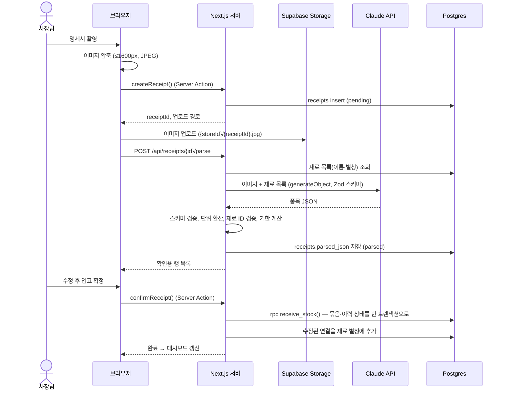
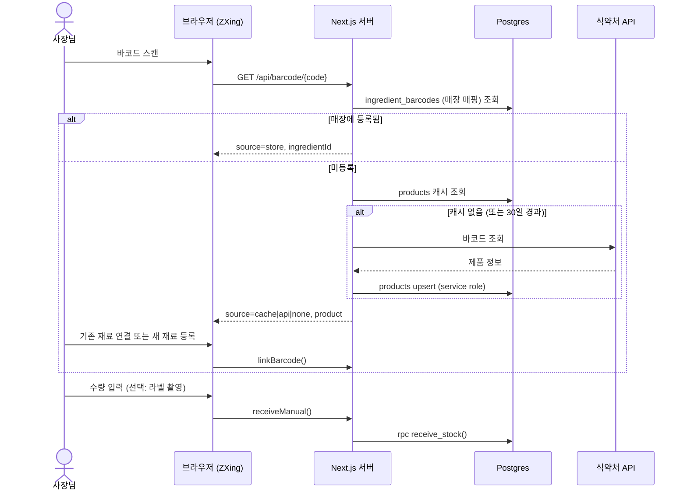
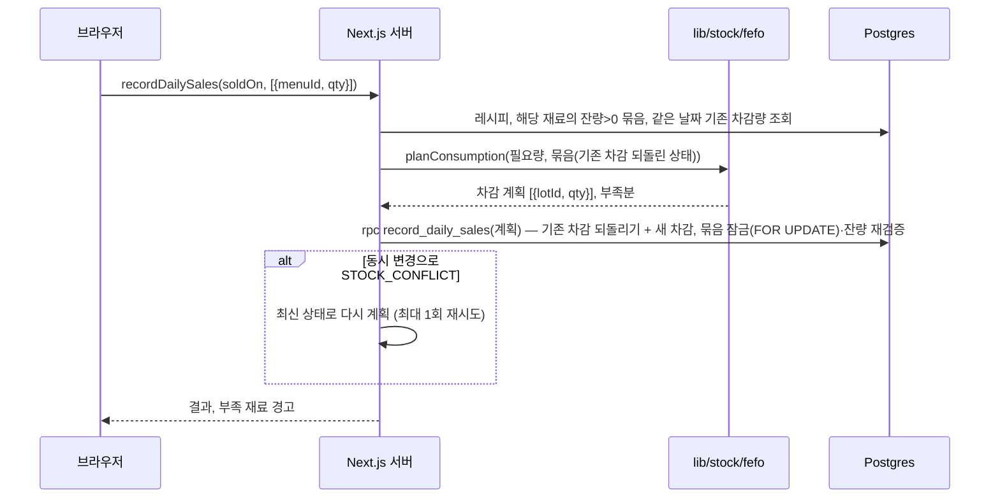

# 아키텍처 설계서

**시스템:** 재고콕 — 소상공인용 식자재 재고 관리 및 AI 메뉴 추천 시스템
**버전:** v0.2 / 2026-10-27
**관련 문서:** `03_SRS.md`, `08_API_SPEC.md`, `07_DB.md`, `09_DESIGN.md`

---

## 1. 설계 원칙

| 원칙 | 내용 |
|---|---|
| **AI는 제안만 한다** | AI 출력은 사용자 확인 없이 재고·재료·메뉴에 반영하지 않는다 (SRS BR-04) |
| **계산은 코드가 한다** | 날짜 계산, 단위 환산, 원가 계산, FEFO 차감은 AI가 아니라 순수 함수가 한다 |
| **재고 변경은 원자적으로** | 재고를 바꾸는 작업은 Postgres 함수(RPC) 하나로 처리해 부분 반영을 막는다 |
| **이력은 지우지 않는다** | `stock_movements`는 추가만 한다. 되돌리기는 반대 방향 이력을 추가한다 |
| **비밀은 서버에만** | Claude·식약처 API 키는 서버 환경변수로만 쓴다 |
| **외부 의존은 감싼다** | AI·외부 API는 `lib/ai`, `lib/external` 뒤에 숨겨 교체·목(mock) 처리가 쉽게 한다 |

## 2. 시스템 구성도

```text
┌───────────────────────────── 휴대폰 브라우저 ─────────────────────────────┐
│  Next.js 클라이언트 컴포넌트 (shadcn/ui, Tailwind)                          │
│  - ZXing 바코드 스캐너       - 이미지 압축 후 업로드                          │
│  - 확인 화면 편집            - 기한 미리보기 (lib/stock 순수 함수 공유)        │
└───────────────┬───────────────────────────────────────────────────────────┘
                │ HTTPS (Server Actions / Route Handlers / Supabase Storage 업로드)
┌───────────────▼──────────────── Vercel (Next.js 서버) ────────────────────┐
│  app/ (RSC 페이지)  ──▶  lib/queries (조회)                                 │
│  actions/ (Server Actions: 변경)                                           │
│  app/api/ (Route Handlers: AI·외부 API, maxDuration 60s)                    │
│        │                    │                        │                     │
│        ▼                    ▼                        ▼                     │
│  lib/stock (도메인 순수 함수)  lib/ai (프롬프트·스키마·검증)  lib/external (어댑터) │
└────────┬───────────────────────┬──────────────────────────┬───────────────┘
         ▼                       ▼                          ▼
 ┌──────────────┐       ┌─────────────────┐     ┌─────────────────────────┐
 │  Supabase     │       │  Claude API      │     │ 식약처 바코드 API         │
 │  Postgres+RLS │       │  Sonnet 5.5      │     │ 축산물 이력제 API (선택)   │
 │  RPC 함수     │       │  Haiku 5.5       │     └─────────────────────────┘
 │  Auth         │       └─────────────────┘
 │  Storage      │
 └──────────────┘
```

## 3. 계층 구조

| 계층 | 위치 | 책임 | 의존 가능 대상 |
|---|---|---|---|
| 표현 (UI) | `src/app`, `src/components` | 화면, 폼, 상태 표시 | actions, queries, lib/stock(순수 함수) |
| 진입점 | `src/actions`, `src/app/api` | 인증 확인, 입력 검증(Zod), 유스케이스 조합, 결과 변환 | lib/* |
| 도메인 | `src/lib/stock` | FEFO 계획, 기한 계산, 단위 환산, 원가 계산 | **없음 (순수 함수)** |
| AI | `src/lib/ai` | 프롬프트, 출력 스키마, 후처리 검증 | lib/stock (검증용) |
| 외부 연동 | `src/lib/external` | 식약처·축산물 API 어댑터, 응답 정규화 | - |
| 데이터 | `src/lib/supabase`, `src/lib/queries`, `supabase/migrations` | 클라이언트 생성, 조회 쿼리, 스키마·RLS·RPC | - |

**규칙:** 도메인 계층(`lib/stock`)은 DB·네트워크·`Date.now()`에 의존하지 않는다. 오늘 날짜도 인자로 받는다. 그래야 단위 테스트가 쉽다.

## 4. 폴더 구조

```text
src/
  app/
    (auth)/login/  (auth)/onboarding/
    (main)/
      page.tsx                     # 대시보드
      ingredients/  [id]/
      receive/  receipt/[id]/  barcode/
      sales/  menus/  [id]/  recommend/  waste/
      layout.tsx                   # 하단 탭
    api/
      receipts/[id]/parse/route.ts
      labels/parse/route.ts
      barcode/[code]/route.ts
      livestock/[traceNo]/route.ts
      recommendations/route.ts
  actions/
    store.ts  ingredients.ts  menus.ts  receive.ts  sales.ts  waste.ts  recommend.ts
  lib/
    stock/       expiry.ts  fefo.ts  unit.ts  cost.ts  safety.ts  normalize.ts  *.test.ts
    ai/          client.ts  receipt.ts  label.ts  storage.ts  recommend.ts  schemas.ts
    external/    foodsafety.ts  livestock.ts
    supabase/    server.ts  client.ts  admin.ts
    queries/     dashboard.ts  ingredients.ts  menus.ts  sales.ts
    result.ts    # ActionResult, 에러 코드
    date.ts      # KST 기준 오늘 날짜
  components/
    ui/  receive/  dashboard/  common/
  types/database.ts                # supabase gen types 결과
supabase/
  migrations/  seed.sql
tests/e2e/                         # Playwright
```

## 5. 주요 흐름

### 5.1 명세서 입고



### 5.2 바코드 입고



### 5.3 판매 마감 (FEFO 차감)



## 6. 트랜잭션 전략

Supabase JS 클라이언트는 여러 쿼리를 하나의 트랜잭션으로 묶을 수 없다. 그래서 다음과 같이 나눈다.

| 단계 | 담당 | 이유 |
|---|---|---|
| **계획** (무엇을 얼마나 바꿀지) | TypeScript 순수 함수 (`lib/stock`) | 단위 테스트가 쉽고 로직이 한 곳에 있음 |
| **적용** (잠금, 재검증, 반영, 이력) | Postgres 함수 (RPC) | 원자성 보장. 계획 이후 재고가 바뀌었으면 `STOCK_CONFLICT`로 거부 |

- 교착 방지: 계획의 묶음 목록은 `lot_id` 순으로 정렬해 전달한다.
- RPC는 `security invoker`로 만들어 RLS가 그대로 적용된다.
- 함수 목록과 SQL은 `07_DB.md` 참고.

## 7. AI 계층

| 기능 | 모델 | 진입점 | 출력 스키마 |
|---|---|---|---|
| 명세서 인식 | `claude-sonnet-5-5` | `POST /api/receipts/[id]/parse` | `ReceiptParse` |
| 라벨 날짜 인식 | `claude-sonnet-5-5` | `POST /api/labels/parse` | `LabelDate` |
| 보관일수 추천 | `claude-haiku-5-5` | `suggestStorage()` | `StorageSuggestion` |
| 메뉴 추천 | `claude-sonnet-5-5` | `POST /api/recommendations` | `Recommendation` |

**공통 처리 순서**
1. 입력 구성 (매장 데이터를 ID와 함께 전달)
2. `generateObject({ model, schema, messages })`로 호출, 타임아웃 45초
3. 스키마 검증 실패 시 1회 재시도, 다시 실패하면 `AI_INVALID_OUTPUT`
4. **후처리 검증:** ID 존재 확인, 재고 충분 여부, 날짜 형식, 단위 허용값
5. 서버 계산으로 덮어쓰기: 단위 환산, 기한, 원가

- 모델 ID와 프롬프트는 `lib/ai` 안에서만 관리한다.
- 개발·테스트 환경에서는 `AI_MOCK=1`이면 `lib/ai/__fixtures__`의 고정 응답을 돌려준다.

## 8. 외부 API 어댑터

```ts
// lib/external/foodsafety.ts
export interface ProductInfo {
  barcode: string;
  name: string;
  maker: string | null;
  foodType: string | null;
  shelfLifeText: string | null; // 예: "제조일로부터 12개월"
}
export async function lookupBarcode(barcode: string): Promise<ProductInfo | null>;
```
- 응답 필드명은 어댑터 안에서만 다루고, 밖으로는 `ProductInfo`만 노출한다.
- 조회 결과는 `products`에 캐시한다. **조회 실패(없음)도 `found=false`로 캐시**해서 같은 바코드로 반복 호출하지 않는다.
- 타임아웃 5초, 실패 시 `EXTERNAL_API_FAILED`를 돌려주고 화면은 수동 등록으로 진행한다.

## 9. 보안

| 항목 | 방식 |
|---|---|
| 인증 | Supabase Auth (매직링크/소셜), `@supabase/ssr`로 쿠키 세션 |
| 인가 | 모든 매장 테이블에 RLS `is_my_store(store_id)` |
| 공용 캐시 | `products`는 인증 사용자 읽기만 가능, 쓰기는 서버의 service role 클라이언트만 |
| service role 키 | `lib/supabase/admin.ts`에서만 사용, `import 'server-only'` 강제 |
| 파일 | Storage `receipts` 비공개 버킷, 경로 첫 폴더가 본인 매장 ID일 때만 접근 |
| 입력 검증 | 모든 Server Action과 Route Handler 입구에서 Zod 검증 |
| 업로드 제한 | 이미지 MIME(jpeg/png/webp)만, 압축 후 5MB 이하 |
| AI 비용 | 매장당 AI 호출 일일 한도(기본 100회), 초과 시 `RATE_LIMITED` |

## 10. 날짜·숫자 규칙

- **기준 시간대는 Asia/Seoul.** "오늘"은 서버의 `lib/date.ts`의 `todayKST()`로만 구한다. DB의 `current_date`(UTC)에 의존하지 않는다.
- 날짜만 필요한 값(입고일, 기한, 판매일)은 Postgres `date` 타입, ISO `YYYY-MM-DD` 문자열로 주고받는다.
- 수량은 `numeric(12,3)`, 기본 단위(g/ml/ea)로 저장한다.
- 금액은 원 단위 정수. 기본 단위당 단가만 `numeric(12,4)`.
- 소수 연산 결과는 소수 3자리로 반올림한다.
- 기간(일·월·년) 계산은 SRS BR-01의 달력 규칙을 따른다.
- 재료 별칭은 소문자·공백 제거 형태로 저장·비교한다 (`lib/stock/normalize.ts`).

## 11. 배포·환경

| 환경 | 용도 | DB |
|---|---|---|
| local | 개발 | Supabase CLI 로컬 (`supabase start`) |
| preview | PR마다 Vercel 미리보기 | Supabase 개발 프로젝트 |
| production | 시연 | Supabase 운영 프로젝트 |

**환경변수**

| 이름 | 범위 | 설명 |
|---|---|---|
| `NEXT_PUBLIC_SUPABASE_URL` | 공개 | Supabase URL |
| `NEXT_PUBLIC_SUPABASE_ANON_KEY` | 공개 | anon 키 (RLS로 보호) |
| `SUPABASE_SERVICE_ROLE_KEY` | 서버 | products 캐시 쓰기 전용 |
| `ANTHROPIC_API_KEY` | 서버 | Claude API |
| `FOODSAFETY_API_KEY` | 서버 | 식약처 API |
| `LIVESTOCK_API_KEY` | 서버 | 축산물 이력제 API (선택) |
| `AI_MOCK` | 서버 | `1`이면 AI 고정 응답 사용 |
| `AI_DAILY_LIMIT` | 서버 | 매장당 AI 일일 호출 한도 |

- AI를 호출하는 Route Handler는 `export const maxDuration = 60`을 설정한다.

## 12. 에러 처리

- Server Action과 Route Handler는 예외를 밖으로 던지지 않고 `ActionResult`로 돌려준다 (`08_API_SPEC.md` 1장).
- RPC 예외 메시지(`STOCK_CONFLICT`, `FORBIDDEN` 등)는 `lib/result.ts`에서 에러 코드로 변환한다.
- 화면은 에러 코드별 안내 문구를 보여주고, AI·외부 API 실패 시 항상 **수동 입력으로 진행할 길**을 제공한다.

## 13. 주요 설계 결정 (ADR 요약)

| # | 결정 | 대안 | 이유 |
|---|---|---|---|
| 1 | Next.js 풀스택 (별도 백엔드 없음) | Spring/FastAPI 분리 | 3명·5주, 배포·인증 연동 비용 절감 |
| 2 | Supabase | Firebase | 재고·레시피는 관계형 데이터, RLS로 매장 격리 |
| 3 | 재고를 묶음 단위로 관리 | 재료별 총량 | 기한 추적과 FEFO에 필수 |
| 4 | 계획은 TS, 적용은 RPC | 전부 SQL / 전부 TS | 테스트 용이성 + 원자성 |
| 5 | 이력 추가 전용 | 수정·삭제 허용 | 감사 추적, 되돌리기 단순화 |
| 6 | AI 출력은 Zod 스키마로 강제 + 서버 재검증 | 자유 텍스트 파싱 | 환각·형식 오류 차단 |
| 7 | 외부 API 실패도 캐시 | 매번 호출 | 비용·속도, 조회율 통계 확보 |
