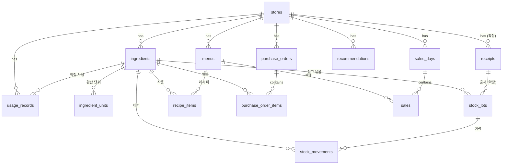

# DB 설계서

**시스템:** 재고콕
**DBMS:** PostgreSQL (Supabase)
**버전:** v0.3 / 2026-11-03

> 이 문서가 스키마의 기준이다. 다른 문서는 테이블 구조를 다시 적지 않고 이 문서를 참조한다.
> 범위는 요구사항 정의서(`03_SRS.md`) v0.4를 따른다. 확장 기능 전용 스키마는 10장에 따로 둔다.

---

## 1. ERD



[크게 보기 (HTML)](diagrams/erd.html)

> 모든 테이블은 `store_id`로 `stores`에 속한다(1:N). 그림에서는 이 연결선을 생략했다.

<details>
<summary>Mermaid 원본</summary>



</details>

`receipts`는 확장 기능(명세서 사진 입고, WBS 4.7)에서만 만든다 (10.1).

## 2. 테이블 요약

| 테이블 | 설명 | 주요 제약 | 관련 요구사항 |
|---|---|---|---|
| `stores` | 매장 (MVP: 사용자당 1개) | `owner_id` 유일 | FR-AUTH-02~03 |
| `ingredients` | 재료 마스터 | `(store_id, name)` 유일, 적정 재고 ≥ 최소 재고 | FR-ING-01 |
| `ingredient_units` | 재료별 환산 단위 (단, 박스, 판 → 기본 단위) | PK `(ingredient_id, unit_name)`, 계수 > 0 | FR-ING-01, BR-03 |
| `stock_lots` | 입고 묶음 (재고의 실체) | `0 ≤ remaining ≤ quantity` | FR-STK-01~04, DR-01 |
| `stock_movements` | 재고 이력 (추가 전용) | `delta ≠ 0` | DR-02 |
| `menus` | 메뉴 | `(store_id, name)` 유일 | FR-MENU-01 |
| `recipe_items` | 메뉴별 재료 1인분 소요량 | PK `(menu_id, ingredient_id)` | FR-MENU-02 |
| `sales_days` | 날짜별 판매 마감과 부족 기록 | `(store_id, sold_on)` 유일 | FR-USE-01, 05 |
| `sales` | 메뉴별 판매 수량 | `(sales_day_id, menu_id)` 유일 | FR-USE-01 |
| `usage_records` | 메뉴와 상관없는 직접 사용과 부족 기록 | `qty > 0` | FR-USE-03, 05 |
| `purchase_orders` | 발주 목록 | 상태 draft → ordered → received | FR-ORD-01~05 |
| `purchase_order_items` | 발주 품목 | PK `(order_id, ingredient_id)`, `qty > 0` | FR-ORD-01~02 |
| `recommendations` | AI 추천 입력·결과·검증 기록 | `basis` 3종 | FR-REC-06, 08 |
| `ai_usage` | 매장별 AI 일일 호출 수 | PK `(store_id, used_on)` | NFR-12 |

**재고 수량의 기준은 `stock_lots.remaining`의 합**이다. `stock_movements`는 이력·통계용이다.
**사용 가능 재고**는 경과하지 않은 묶음의 잔량 합이다 (SRS BR-05). 계산은 3.4의 `get_ingredient_stock`으로 한다.

## 3. 마이그레이션 SQL

### 3.1 타입
> `stores` 테이블, `pgcrypto`, `is_my_store()`, `stores_owner` 정책은 WBS 2.4에서 `supabase/migrations/0000_stores.sql`로 먼저 만들었다. `0001_init`·`0002_rls`를 실제 파일로 옮길 때 이 부분은 빼고 쓴다.

```sql
-- supabase/migrations/0001_init.sql
create extension if not exists pgcrypto;

create type unit_type      as enum ('g', 'ml', 'ea');
create type storage_type   as enum ('fridge', 'freezer', 'room');  -- 식품공전: 냉장 0~10℃ / 냉동 -18℃ 이하 / 실온 1~35℃
create type expiry_source  as enum ('manual', 'default');           -- SRS BR-01
create type movement_type  as enum ('in', 'use', 'waste', 'adjust');
create type order_status   as enum ('draft', 'ordered', 'received'); -- 작성중 / 발주완료 / 입고완료
```

### 3.2 테이블
```sql
create table stores (
  id          uuid primary key default gen_random_uuid(),
  owner_id    uuid not null unique references auth.users(id) on delete cascade,
  name        text not null check (char_length(name) between 1 and 50),
  created_at  timestamptz not null default now()
);

create table ingredients (
  id                  uuid primary key default gen_random_uuid(),
  store_id            uuid not null references stores(id) on delete cascade,
  name                text not null check (char_length(name) between 1 and 30),
  category            text,
  unit                unit_type not null,
  min_stock           numeric(12,3) not null default 0 check (min_stock >= 0),
  target_stock        numeric(12,3),                                  -- 적정 재고, 없으면 최소 재고 × 2 (BR-06)
  storage             storage_type not null default 'fridge',
  default_shelf_days  int check (default_shelf_days between 1 and 3650),
  track_expiry        boolean not null default true,                  -- 소금·설탕 등은 false (BR-01)
  is_active           boolean not null default true,
  created_at          timestamptz not null default now(),
  updated_at          timestamptz not null default now(),
  unique (store_id, name),
  check (not track_expiry or default_shelf_days is not null),
  check (target_stock is null or target_stock >= min_stock)
);

create table ingredient_units (
  store_id       uuid not null references stores(id) on delete cascade,
  ingredient_id  uuid not null references ingredients(id) on delete cascade,
  unit_name      text not null check (char_length(unit_name) between 1 and 10),  -- "단", "박스", "판"
  factor         numeric(12,4) not null check (factor > 0),                      -- 1단위당 기본 단위 양
  primary key (ingredient_id, unit_name)
);

create table stock_lots (
  id              uuid primary key default gen_random_uuid(),
  store_id        uuid not null references stores(id) on delete cascade,
  ingredient_id   uuid not null references ingredients(id) on delete restrict,
  quantity        numeric(12,3) not null check (quantity > 0),
  remaining       numeric(12,3) not null,
  unit_price      numeric(12,4) check (unit_price >= 0),      -- 원 / 기본 단위, 서버가 품목 금액에서 계산
  received_at     date not null,
  expires_at      date,                                       -- 기한 추적 제외 재료는 null
  expiry_source   expiry_source,
  receipt_id      uuid,                                       -- 확장(10.1)에서 receipts FK 추가
  created_at      timestamptz not null default now(),
  check (remaining >= 0 and remaining <= quantity),
  check ((expires_at is null) = (expiry_source is null)),
  check (expires_at is null or expires_at >= received_at)
);

create table stock_movements (
  id             uuid primary key default gen_random_uuid(),
  store_id       uuid not null references stores(id) on delete cascade,
  ingredient_id  uuid not null references ingredients(id) on delete restrict,
  lot_id         uuid references stock_lots(id) on delete restrict,
  type           movement_type not null,
  delta          numeric(12,3) not null check (delta <> 0),  -- 입고 +, 사용·폐기 -, 조정 ±
  reason         text,      -- 폐기: expired|spoiled|mistake|other, 조정: count|sales_revision
  memo           text,
  ref_type       text not null check (ref_type in ('receipt', 'manual', 'sales', 'usage', 'waste', 'adjust')),
  ref_id         uuid,
  created_at     timestamptz not null default now()
);

create table menus (
  id          uuid primary key default gen_random_uuid(),
  store_id    uuid not null references stores(id) on delete cascade,
  name        text not null check (char_length(name) between 1 and 30),
  price       int not null check (price >= 0),
  is_active   boolean not null default true,
  is_special  boolean not null default false,                -- AI 특선에서 등록 (FR-REC-07)
  created_at  timestamptz not null default now(),
  unique (store_id, name)
);

create table recipe_items (
  store_id       uuid not null references stores(id) on delete cascade,
  menu_id        uuid not null references menus(id) on delete cascade,
  ingredient_id  uuid not null references ingredients(id) on delete restrict,
  qty            numeric(12,3) not null check (qty > 0),     -- 1인분, 기본 단위
  primary key (menu_id, ingredient_id)
);

create table sales_days (
  id          uuid primary key default gen_random_uuid(),
  store_id    uuid not null references stores(id) on delete cascade,
  sold_on     date not null,
  shortages   jsonb not null default '[]',                   -- [{ingredient_id, required_qty, short_qty}] (FR-USE-05)
  updated_at  timestamptz not null default now(),
  unique (store_id, sold_on)
);

create table sales (
  id            uuid primary key default gen_random_uuid(),
  store_id      uuid not null references stores(id) on delete cascade,
  sales_day_id  uuid not null references sales_days(id) on delete cascade,
  menu_id       uuid not null references menus(id) on delete restrict,
  qty           int not null check (qty > 0),
  unique (sales_day_id, menu_id)
);

create table usage_records (
  id             uuid primary key default gen_random_uuid(),
  store_id       uuid not null references stores(id) on delete cascade,
  used_on        date not null,
  ingredient_id  uuid not null references ingredients(id) on delete restrict,
  qty            numeric(12,3) not null check (qty > 0),     -- 요청한 사용량, 기본 단위
  short_qty      numeric(12,3) not null default 0 check (short_qty >= 0 and short_qty <= qty),  -- 차감하지 못한 양 (FR-USE-05)
  memo           text check (char_length(memo) <= 100),      -- 직원 식사, 시식 등
  created_at     timestamptz not null default now()
);

create table purchase_orders (
  id           uuid primary key default gen_random_uuid(),
  store_id     uuid not null references stores(id) on delete cascade,
  status       order_status not null default 'draft',
  order_date   date not null,
  memo         text check (char_length(memo) <= 200),
  ordered_at   timestamptz,
  received_at  timestamptz,
  created_at   timestamptz not null default now(),
  updated_at   timestamptz not null default now()
);

create table purchase_order_items (
  order_id       uuid not null references purchase_orders(id) on delete cascade,
  store_id       uuid not null references stores(id) on delete cascade,
  ingredient_id  uuid not null references ingredients(id) on delete restrict,
  qty            numeric(12,3) not null check (qty > 0),     -- 기본 단위
  primary key (order_id, ingredient_id)
);

create table recommendations (
  id                  uuid primary key default gen_random_uuid(),
  store_id            uuid not null references stores(id) on delete cascade,
  basis               text not null default 'expiry' check (basis in ('expiry', 'cost', 'popularity')),  -- FR-REC-06
  input_snapshot      jsonb not null,
  result_json         jsonb not null,                        -- 검증 후 RecommendationView
  dropped_count       int not null default 0,                -- 없는 메뉴·형식 오류로 제외 (FR-REC-04)
  short_count         int not null default 0,                -- status = short 재료 수 (FR-REC-03)
  unregistered_count  int not null default 0,                -- status = unregistered 재료 수
  fallback            boolean not null default false,        -- AI 실패 후 규칙 기반 대체 (UC-08 3a)
  accepted            boolean not null default false,        -- 특선 등록 여부 (FR-REC-07)
  created_at          timestamptz not null default now()
);

create table ai_usage (
  store_id  uuid not null references stores(id) on delete cascade,
  used_on   date not null,
  count     int not null default 0,
  primary key (store_id, used_on)
);
```

### 3.3 인덱스
```sql
create index idx_lots_active       on stock_lots (store_id, ingredient_id, expires_at) where remaining > 0;
create index idx_lots_expiring     on stock_lots (store_id, expires_at) where remaining > 0 and expires_at is not null;
create index idx_movements_ref     on stock_movements (ref_type, ref_id);
create index idx_movements_store   on stock_movements (store_id, created_at desc);
create index idx_movements_waste   on stock_movements (store_id, created_at) where type = 'waste';
create index idx_usage_store       on usage_records (store_id, used_on desc);
create index idx_orders_store      on purchase_orders (store_id, order_date desc);
create index idx_order_items_ing   on purchase_order_items (store_id, ingredient_id);
create index idx_recs_store        on recommendations (store_id, created_at desc);
```

### 3.4 재고 요약 함수
```sql
-- 재료별 재고 요약. 오늘은 서버가 todayKST()로 넘긴다 (DB에서 오늘을 구하지 않음)
-- security invoker라 RLS가 그대로 적용된다
create or replace function get_ingredient_stock(p_store_id uuid, p_today date)
returns table (
  ingredient_id       uuid,
  name                text,
  unit                unit_type,
  min_stock           numeric,
  target_stock        numeric,
  total_remaining     numeric,
  available_remaining numeric,   -- 경과하지 않은 묶음 잔량 합 (BR-05)
  expired_remaining   numeric,   -- 경과 묶음 잔량 합 (폐기 안내 대상)
  nearest_expires_at  date,      -- 경과 묶음 포함 가장 빠른 기한 (목록 배지용)
  is_low              boolean    -- 최소 재고 > 0 이고 사용 가능 재고 < 최소 재고
)
language sql stable security invoker set search_path = public
as $$
  select i.id, i.name, i.unit, i.min_stock, i.target_stock,
         coalesce(sum(l.remaining), 0),
         coalesce(sum(l.remaining) filter (where l.expires_at is null or l.expires_at >= p_today), 0),
         coalesce(sum(l.remaining) filter (where l.expires_at < p_today), 0),
         min(l.expires_at),
         i.min_stock > 0
           and coalesce(sum(l.remaining) filter (where l.expires_at is null or l.expires_at >= p_today), 0) < i.min_stock
    from ingredients i
    left join stock_lots l on l.ingredient_id = i.id and l.remaining > 0
   where i.store_id = p_store_id and i.is_active
   group by i.id;
$$;
```

## 4. RLS 정책

```sql
-- supabase/migrations/0002_rls.sql
create or replace function is_my_store(sid uuid)
returns boolean
language sql stable security definer set search_path = public
as $$
  select exists (select 1 from stores where id = sid and owner_id = auth.uid());
$$;

alter table stores               enable row level security;
alter table ingredients          enable row level security;
alter table ingredient_units     enable row level security;
alter table stock_lots           enable row level security;
alter table stock_movements      enable row level security;
alter table menus                enable row level security;
alter table recipe_items         enable row level security;
alter table sales_days           enable row level security;
alter table sales                enable row level security;
alter table usage_records        enable row level security;
alter table purchase_orders      enable row level security;
alter table purchase_order_items enable row level security;
alter table recommendations      enable row level security;
alter table ai_usage             enable row level security;

create policy stores_owner on stores
  for all using (owner_id = auth.uid()) with check (owner_id = auth.uid());

-- 매장 소유 테이블: 같은 패턴
do $$
declare t text;
begin
  foreach t in array array[
    'ingredients', 'ingredient_units', 'stock_lots', 'menus', 'recipe_items',
    'sales_days', 'sales', 'usage_records', 'purchase_orders', 'purchase_order_items',
    'recommendations', 'ai_usage'
  ] loop
    execute format(
      'create policy %I on %I for all using (is_my_store(store_id)) with check (is_my_store(store_id))',
      t || '_store', t);
  end loop;
end $$;

-- 이력은 추가·조회만 (수정·삭제 정책 없음 → 거부)
create policy movements_select on stock_movements for select using (is_my_store(store_id));
create policy movements_insert on stock_movements for insert with check (is_my_store(store_id));
```

- RLS는 행의 `store_id`만 검사한다. 다른 매장의 재료·메뉴 ID를 참조하지 못하게 하는 검사는 서버 액션에서 하고, RPC가 한 번 더 확인한다 (5장).
- service role 키는 쓰지 않는다. 모든 접근은 로그인 사용자 권한으로 한다.

## 5. RPC 함수 (원자적 변경)

> 모두 `security invoker` — 호출한 사용자의 RLS가 그대로 적용된다.
> 계획(무엇을 얼마나)은 서버 TypeScript(`lib/stock`)가 만들고, 함수는 **잠금 → 재검증 → 반영 → 이력**만 한다.
> 날짜 인자(`p_sold_on`, `p_used_on` 등)는 서버가 넘긴다.

| 함수 | 용도 | 호출하는 서버 액션 (`08_API_SPEC.md`) |
|---|---|---|
| `receive_stock` | 입고 | `receiveStock` |
| `apply_consumption` | 묶음 차감 공통 (다른 RPC 안에서만 호출) | - |
| `record_daily_sales` | 판매 마감 | `recordDailySales` |
| `record_usage` | 직접 사용 | `recordUsage` |
| `record_waste` | 폐기 | `recordWaste` |
| `save_order` | 발주 목록 저장 (품목 통째 교체) | `saveOrder` |
| `adjust_lot` | 실사 보정 (확장) | `adjustLot` |
| `increment_ai_usage` | AI 호출 한도 | AI Route Handler |

### 5.1 `receive_stock` — 입고
```sql
-- supabase/migrations/0003_rpc.sql
create or replace function receive_stock(
  p_store_id  uuid,
  p_ref_type  text,          -- 'manual' (확장 명세서 입고는 'receipt')
  p_ref_id    uuid,          -- 명세서 입고면 receipt id, 아니면 null
  p_lots      jsonb          -- [{ingredient_id, quantity, unit_price, received_at, expires_at, expiry_source}]
) returns setof uuid
language plpgsql security invoker set search_path = public
as $$
declare
  e     jsonb;
  v_lot uuid;
begin
  if not is_my_store(p_store_id) then raise exception 'FORBIDDEN'; end if;
  if p_ref_type not in ('manual', 'receipt') then raise exception 'VALIDATION'; end if;

  for e in select * from jsonb_array_elements(p_lots) loop
    if not exists (select 1 from ingredients
                   where id = (e->>'ingredient_id')::uuid and store_id = p_store_id and is_active) then
      raise exception 'NOT_FOUND';
    end if;

    insert into stock_lots (store_id, ingredient_id, quantity, remaining, unit_price,
                            received_at, expires_at, expiry_source, receipt_id)
    values (p_store_id,
            (e->>'ingredient_id')::uuid,
            (e->>'quantity')::numeric,
            (e->>'quantity')::numeric,
            (e->>'unit_price')::numeric,
            (e->>'received_at')::date,
            (e->>'expires_at')::date,
            (e->>'expiry_source')::expiry_source,
            case when p_ref_type = 'receipt' then p_ref_id end)
    returning id into v_lot;

    insert into stock_movements (store_id, ingredient_id, lot_id, type, delta, ref_type, ref_id)
    values (p_store_id, (e->>'ingredient_id')::uuid, v_lot, 'in', (e->>'quantity')::numeric,
            p_ref_type, coalesce(p_ref_id, v_lot));

    return next v_lot;
  end loop;
end $$;
```

### 5.2 `apply_consumption` — 묶음 차감 (공통)
```sql
create or replace function apply_consumption(
  p_store_id  uuid,
  p_type      movement_type,   -- 'use' | 'waste'
  p_ref_type  text,            -- 'sales' | 'usage' | 'waste'
  p_ref_id    uuid,
  p_reason    text,
  p_memo      text,
  p_base_date date,            -- 'use'일 때 판매일·사용일. 이 날 기준 경과 묶음은 거부 (BR-02)
  p_items     jsonb            -- [{lot_id, qty}]  (lot_id 오름차순 정렬해서 전달)
) returns void
language plpgsql security invoker set search_path = public
as $$
declare
  e           jsonb;
  v_qty       numeric;
  v_remaining numeric;
  v_expires   date;
  v_ing       uuid;
begin
  if not is_my_store(p_store_id) then raise exception 'FORBIDDEN'; end if;
  if p_type not in ('use', 'waste') then raise exception 'VALIDATION'; end if;

  for e in select * from jsonb_array_elements(p_items) loop
    v_qty := (e->>'qty')::numeric;
    if v_qty <= 0 then raise exception 'VALIDATION'; end if;

    select remaining, expires_at, ingredient_id into v_remaining, v_expires, v_ing
      from stock_lots
     where id = (e->>'lot_id')::uuid and store_id = p_store_id
       for update;

    if not found then raise exception 'NOT_FOUND'; end if;
    -- 계획 이후 재고가 바뀌었거나, 사용 차감인데 기준일에 경과한 묶음이면 다시 계획하게 한다
    if v_remaining < v_qty then raise exception 'STOCK_CONFLICT'; end if;
    if p_type = 'use' and v_expires is not null and v_expires < p_base_date then
      raise exception 'STOCK_CONFLICT';
    end if;

    update stock_lots set remaining = remaining - v_qty where id = (e->>'lot_id')::uuid;

    insert into stock_movements (store_id, ingredient_id, lot_id, type, delta, reason, memo, ref_type, ref_id)
    values (p_store_id, v_ing, (e->>'lot_id')::uuid, p_type, -v_qty, p_reason, p_memo, p_ref_type,
            coalesce(p_ref_id, (e->>'lot_id')::uuid));
  end loop;
end $$;
```

### 5.3 `record_daily_sales` — 판매 마감
```sql
create or replace function record_daily_sales(
  p_store_id  uuid,
  p_sold_on   date,
  p_sales     jsonb,   -- [{menu_id, qty}]
  p_plan      jsonb,   -- [{lot_id, qty}]  FEFO 계획 (경과 묶음 제외, lot_id 오름차순)
  p_shortages jsonb    -- [{ingredient_id, required_qty, short_qty}]
) returns uuid
language plpgsql security invoker set search_path = public
as $$
declare
  v_day uuid;
begin
  if not is_my_store(p_store_id) then raise exception 'FORBIDDEN'; end if;

  -- 같은 날짜를 다시 마감하는 기능(FR-USE-06)은 확장. 구현 전에는 거부한다 (10.2에서 교체)
  if exists (select 1 from sales_days where store_id = p_store_id and sold_on = p_sold_on) then
    raise exception 'CONFLICT';
  end if;

  insert into sales_days (store_id, sold_on, shortages)
  values (p_store_id, p_sold_on, p_shortages)
  returning id into v_day;

  insert into sales (store_id, sales_day_id, menu_id, qty)
  select p_store_id, v_day, (x->>'menu_id')::uuid, (x->>'qty')::int
    from jsonb_array_elements(p_sales) x
   where (x->>'qty')::int > 0;

  -- 차감 적용 (잔량·경과 재검증 포함)
  perform apply_consumption(p_store_id, 'use', 'sales', v_day, null, null, p_sold_on, p_plan);

  return v_day;
end $$;
```

### 5.4 `record_usage` — 직접 사용
```sql
create or replace function record_usage(
  p_store_id uuid,
  p_used_on  date,
  p_items    jsonb,   -- [{ingredient_id, qty, short_qty, memo}]  재료 중복 없음, ingredient_id 오름차순
  p_plan     jsonb    -- [{ingredient_id, lot_id, qty}]  FEFO 계획 (경과 묶음 제외)
) returns setof uuid
language plpgsql security invoker set search_path = public
as $$
declare
  e     jsonb;
  v_rec uuid;
begin
  if not is_my_store(p_store_id) then raise exception 'FORBIDDEN'; end if;

  for e in select * from jsonb_array_elements(p_items) loop
    insert into usage_records (store_id, used_on, ingredient_id, qty, short_qty, memo)
    values (p_store_id, p_used_on, (e->>'ingredient_id')::uuid, (e->>'qty')::numeric,
            coalesce((e->>'short_qty')::numeric, 0), e->>'memo')
    returning id into v_rec;

    -- 이 재료의 계획만 골라 차감. 이력의 ref_id는 사용 기록 id
    perform apply_consumption(p_store_id, 'use', 'usage', v_rec, null, e->>'memo', p_used_on,
      coalesce((select jsonb_agg(jsonb_build_object('lot_id', x->>'lot_id', 'qty', x->>'qty')
                                 order by x->>'lot_id')
                  from jsonb_array_elements(p_plan) x
                 where x->>'ingredient_id' = e->>'ingredient_id'), '[]'::jsonb));

    return next v_rec;
  end loop;
end $$;
```

### 5.5 `record_waste` — 폐기
```sql
create or replace function record_waste(
  p_store_id uuid,
  p_lot_id   uuid,
  p_qty      numeric,
  p_reason   text,     -- 'expired' | 'spoiled' | 'mistake' | 'other'
  p_memo     text
) returns void
language plpgsql security invoker set search_path = public
as $$
begin
  if p_reason not in ('expired', 'spoiled', 'mistake', 'other') then raise exception 'VALIDATION'; end if;
  -- 폐기는 경과 묶음도 대상이므로 기준일 검사를 하지 않는다 (p_base_date = null)
  perform apply_consumption(p_store_id, 'waste', 'waste', p_lot_id, p_reason, p_memo, null,
                            jsonb_build_array(jsonb_build_object('lot_id', p_lot_id, 'qty', p_qty)));
end $$;
```

### 5.6 `save_order` — 발주 목록 저장
```sql
-- 재고를 바꾸지 않지만, 목록과 품목을 한 번에 교체해야 해서 함수로 묶는다
create or replace function save_order(
  p_store_id   uuid,
  p_order_id   uuid,      -- 새 목록이면 null
  p_order_date date,
  p_memo       text,
  p_items      jsonb      -- [{ingredient_id, qty}]
) returns uuid
language plpgsql security invoker set search_path = public
as $$
declare
  v_id uuid;
begin
  if not is_my_store(p_store_id) then raise exception 'FORBIDDEN'; end if;

  if exists (select 1 from jsonb_array_elements(p_items) x
              where not exists (select 1 from ingredients
                                 where id = (x->>'ingredient_id')::uuid and store_id = p_store_id)) then
    raise exception 'NOT_FOUND';
  end if;

  if p_order_id is null then
    insert into purchase_orders (store_id, order_date, memo)
    values (p_store_id, p_order_date, p_memo)
    returning id into v_id;
  else
    -- 작성중(draft)일 때만 수정할 수 있다 (FR-ORD-03)
    update purchase_orders
       set order_date = p_order_date, memo = p_memo, updated_at = now()
     where id = p_order_id and store_id = p_store_id and status = 'draft'
    returning id into v_id;
    if v_id is null then raise exception 'CONFLICT'; end if;
    delete from purchase_order_items where order_id = v_id;
  end if;

  -- 발주량 0 이하 품목은 저장하지 않는다 (UC-09 3a)
  insert into purchase_order_items (order_id, store_id, ingredient_id, qty)
  select v_id, p_store_id, (x->>'ingredient_id')::uuid, (x->>'qty')::numeric
    from jsonb_array_elements(p_items) x
   where (x->>'qty')::numeric > 0;

  return v_id;
end $$;
```

상태 변경(`setOrderStatus`)은 RPC 없이 조건부 update 한 번으로 한다. 0행이면 `CONFLICT`.

```sql
-- 허용 전이: draft → ordered, ordered → draft, ordered → received
update purchase_orders
   set status = :to, updated_at = now(),
       ordered_at  = case when :to = 'ordered'  then now() else ordered_at end,
       received_at = case when :to = 'received' then now() else received_at end
 where id = :id and store_id = :store_id and status = :from;
```

### 5.7 `adjust_lot` — 실사 보정 (확장, FR-USE-07)
```sql
create or replace function adjust_lot(
  p_lot_id        uuid,
  p_new_remaining numeric,
  p_memo          text
) returns numeric
language plpgsql security invoker set search_path = public
as $$
declare
  v_lot   stock_lots%rowtype;
  v_delta numeric;
begin
  select * into v_lot from stock_lots where id = p_lot_id for update;
  if not found then raise exception 'NOT_FOUND'; end if;
  if not is_my_store(v_lot.store_id) then raise exception 'FORBIDDEN'; end if;
  if p_new_remaining < 0 or p_new_remaining > v_lot.quantity then raise exception 'VALIDATION'; end if;

  v_delta := p_new_remaining - v_lot.remaining;
  if v_delta = 0 then return 0; end if;

  update stock_lots set remaining = p_new_remaining where id = p_lot_id;
  insert into stock_movements (store_id, ingredient_id, lot_id, type, delta, reason, memo, ref_type, ref_id)
  values (v_lot.store_id, v_lot.ingredient_id, p_lot_id, 'adjust', v_delta, 'count', p_memo, 'adjust', p_lot_id);
  return v_delta;
end $$;
```

### 5.8 `increment_ai_usage` — AI 호출 한도
```sql
create or replace function increment_ai_usage(p_store_id uuid, p_today date, p_limit int)
returns int
language plpgsql security invoker set search_path = public
as $$
declare v_count int;
begin
  if not is_my_store(p_store_id) then raise exception 'FORBIDDEN'; end if;
  insert into ai_usage (store_id, used_on, count) values (p_store_id, p_today, 1)
  on conflict (store_id, used_on) do update set count = ai_usage.count + 1
  returning count into v_count;
  if v_count > p_limit then raise exception 'RATE_LIMITED'; end if;
  return v_count;
end $$;
```

## 6. 주요 조회 쿼리

모든 쿼리의 `:today`는 서버가 `todayKST()`로 넘긴다.

```sql
-- 대시보드: 임박 묶음 (D-0 ~ D-3, FR-DASH-01)
select l.id, l.ingredient_id, i.name, l.remaining, i.unit, l.expires_at,
       (l.expires_at - :today) as days_left
  from stock_lots l join ingredients i on i.id = l.ingredient_id
 where l.store_id = :store_id and l.remaining > 0
   and l.expires_at between :today and :today + 3
 order by l.expires_at, i.name;

-- 대시보드: 경과 묶음 (따로 표시, FR-DASH-02)
select l.id, l.ingredient_id, i.name, l.remaining, i.unit, l.expires_at,
       (l.expires_at - :today) as days_left
  from stock_lots l join ingredients i on i.id = l.ingredient_id
 where l.store_id = :store_id and l.remaining > 0
   and l.expires_at < :today
 order by l.expires_at, i.name;

-- 대시보드: 부족 재료 (사용 가능 재고 기준, FR-DASH-03)
select ingredient_id, name, unit, available_remaining, min_stock
  from get_ingredient_stock(:store_id, :today)
 where is_low
 order by name;

-- 발주 초안 입력: 미입고 발주량 (상태 ordered, BR-06)
select oi.ingredient_id, sum(oi.qty) as pending_qty
  from purchase_order_items oi join purchase_orders o on o.id = oi.order_id
 where o.store_id = :store_id and o.status = 'ordered'
 group by oi.ingredient_id;
-- 권장 발주량 계산은 get_ingredient_stock 결과와 함께 lib/stock/order.ts에서 한다

-- FEFO 계획 입력: 재료의 사용 가능한 묶음 (경과 묶음 제외, :base_date = 판매일 또는 사용일, SRS BR-02)
select id, ingredient_id, remaining, expires_at, received_at
  from stock_lots
 where store_id = :store_id and ingredient_id = any(:ingredient_ids) and remaining > 0
   and (expires_at is null or expires_at >= :base_date)
 order by ingredient_id, expires_at nulls last, received_at, id;

-- AI 추천 입력: 최근 7일 메뉴별 판매량 (FR-REC-01, 인기 우선 기준)
select s.menu_id, sum(s.qty) as qty_7d
  from sales s join sales_days d on d.id = s.sales_day_id
 where d.store_id = :store_id and d.sold_on between :today - 7 and :today - 1
 group by s.menu_id;

-- 확장: 주간 폐기 금액 (원, FR-DASH-05)
select date_trunc('day', m.created_at at time zone 'Asia/Seoul')::date as day,
       round(sum(-m.delta * coalesce(l.unit_price, 0)))::int as amount
  from stock_movements m join stock_lots l on l.id = m.lot_id
 where m.store_id = :store_id and m.type = 'waste'
   and m.created_at >= (:week_start)::timestamp at time zone 'Asia/Seoul'
 group by 1 order by 1;
```

## 7. 데이터 규칙

날짜·수량·금액 규칙은 `06_ARCHITECTURE.md` 10장을 따른다. DB에만 해당하는 규칙은 다음과 같다.

| 규칙 | 내용 |
|---|---|
| 날짜 | DB `current_date`·`now()`로 "오늘"을 구하지 않는다. 날짜는 항상 서버가 전달한다. `now()`는 기록 시각(`created_at` 등)에만 쓴다 |
| 삭제 | 재료·메뉴는 비활성화(soft delete). 묶음·이력이 있는 재료는 삭제 불가(`on delete restrict`). 잔량이 남은 재료는 비활성화하지 않는다(서버 액션에서 `CONFLICT`) |
| 이력 | `stock_movements`는 수정·삭제 금지. 되돌리기는 반대 방향 `adjust` 이력 |
| 매장 간 참조 | 다른 매장의 재료·메뉴 ID를 참조하지 않는다. 서버 액션이 먼저 검사하고 RPC가 다시 확인한다 |
| 발주 수량 | 권장 발주량은 정수로 올림한 값으로 저장한다 (BR-06). 사용자가 고친 값은 소수 3자리까지 |
| 발주 상태 | 품목 수정은 `draft`에서만. 전이는 draft → ordered, ordered → draft, ordered → received만 허용 |

## 8. 시드 데이터 (`supabase/seed.sql`)

SRS C-02의 가상 데이터 기준을 따른다. 실제 매장·개인 데이터는 쓰지 않는다.

- 테스트 사용자 1명, 매장 1개 ("테스트 한식당")
- 재료 30종 (채소 10, 육류 5, 수산 4, 유제품·계란 4, 양념·곡류 7), 기본 보관일수 포함
  - 기한 추적 제외 2종 (소금, 설탕), 환산 단위 3개 (대파 "단", 계란 "판", 두부 "모")
  - 적정 재고를 입력한 재료 10종 이상, 나머지는 최소 재고만
- 메뉴 15개와 레시피
- 최근 14일 입고 묶음 (일부는 D-0~D-3 임박, 일부는 기한 경과)
- 최근 14일 판매 마감 기록과 차감 이력, 직접 사용 3건, 폐기 3건
- 사용 가능 재고가 최소 재고 미만인 재료 3종 이상
- 발주 목록 2개 (draft 1, ordered 1)

시드는 `supabase db reset` 한 번으로 데모 상태가 재현되도록 유지한다. 시드의 날짜는 실행일 기준 상대 날짜로 넣는다.

## 9. 스키마 변경 절차
새 마이그레이션 추가 → `supabase db reset` → 타입 재생성 → 이 문서 갱신. 명령어는 루트 `AGENTS.md` 참고.

## 10. 확장 — 착수 시 추가

확장 기능은 필수 기능(F-01~F-05)을 마친 뒤 별도 마이그레이션으로 추가한다.

### 10.1 명세서 사진 입고 (WBS 4.7, FR-RCP-01~03)
```sql
-- supabase/migrations/00xx_receipts.sql
create type receipt_status as enum ('pending', 'parsed', 'confirmed', 'failed');

create table receipts (
  id            uuid primary key default gen_random_uuid(),
  store_id      uuid not null references stores(id) on delete cascade,
  image_path    text not null,
  status        receipt_status not null default 'pending',
  parsed_json   jsonb,
  error         text,
  created_at    timestamptz not null default now(),
  confirmed_at  timestamptz
);

alter table stock_lots
  add constraint stock_lots_receipt_fk foreign key (receipt_id) references receipts(id) on delete set null;

create index idx_receipts_store on receipts (store_id, created_at desc);

alter table receipts enable row level security;
create policy receipts_store on receipts
  for all using (is_my_store(store_id)) with check (is_my_store(store_id));

-- 비공개 버킷 receipts, 경로: {store_id}/{receipt_id}.jpg
insert into storage.buckets (id, name, public) values ('receipts', 'receipts', false)
on conflict (id) do nothing;

create policy receipts_rw on storage.objects for all to authenticated
  using      (bucket_id = 'receipts' and is_my_store(((storage.foldername(name))[1])::uuid))
  with check (bucket_id = 'receipts' and is_my_store(((storage.foldername(name))[1])::uuid));
```

- 확정 시 `receive_stock(p_ref_type => 'receipt', p_ref_id => receipt_id)` 후 같은 트랜잭션에서 `receipts.status`를 `parsed → confirmed`로 바꾼다 (상태가 `parsed`가 아니면 `CONFLICT`). 이를 위해 `confirm_receipt` RPC로 두 작업을 묶는다.

### 10.2 같은 날짜 판매 재입력 (WBS 4.5, FR-USE-06)

5.3의 "이미 마감한 날짜면 `CONFLICT`" 대신, 기존 차감을 되돌리고 다시 차감하는 버전으로 `record_daily_sales`를 교체한다.

```sql
  -- 1) 같은 날짜의 기존 차감 되돌리기 (반대 방향 이력 추가, 순 차감량 기준)
  for r in
    select lot_id, ingredient_id, -sum(delta) as consumed
      from stock_movements
     where ref_type = 'sales' and ref_id = v_day
     group by lot_id, ingredient_id
    having sum(delta) < 0
     order by lot_id
  loop
    update stock_lots set remaining = remaining + r.consumed where id = r.lot_id;
    insert into stock_movements (store_id, ingredient_id, lot_id, type, delta, reason, ref_type, ref_id)
    values (p_store_id, r.ingredient_id, r.lot_id, 'adjust', r.consumed, 'sales_revision', 'sales', v_day);
  end loop;

  -- 2) 판매 기록 교체: delete from sales where sales_day_id = v_day; 후 다시 insert
  -- 3) 새 차감 적용: perform apply_consumption(...)
```

- 서버의 계획(`planConsumption`)은 기존 차감을 되돌린 상태를 기준으로 만든다 (UT-FEFO-06).

## 11. 변경 이력

| 버전 | 날짜 | 내용 |
|---|---|---|
| v0.2 | 2026-10-27 | 초안 |
| v0.3 | 2026-11-03 | SRS v0.4 범위로 개정: 바코드·제품 캐시·라벨·축산물 관련 스키마 삭제, 명세서(receipts)는 확장 절로 이동, 적정 재고·환산 단위·직접 사용·발주 목록 테이블 추가, 재고 요약 뷰를 오늘 날짜를 인자로 받는 함수로 변경, FEFO 차감에서 경과 묶음 거부, 판매 재입력을 확장으로 분리 |
