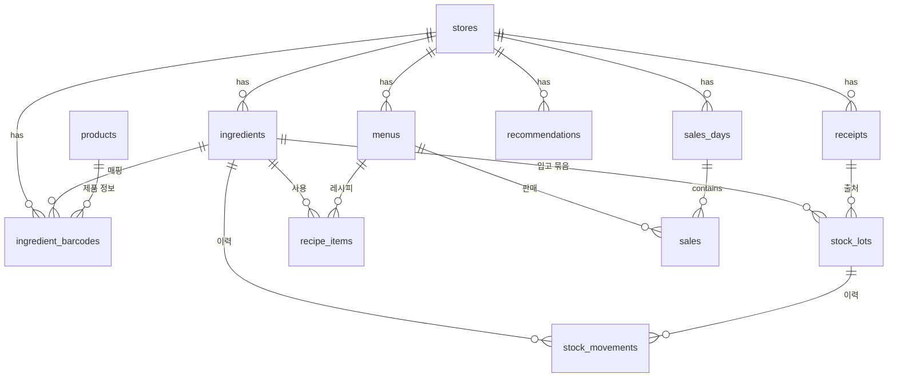

# DB 설계서

**시스템:** 재고콕
**DBMS:** PostgreSQL (Supabase)
**버전:** v0.2 / 2026-10-27

> 이 문서가 스키마의 기준이다. 다른 문서는 테이블 구조를 다시 적지 않고 이 문서를 참조한다.

---

## 1. ERD



## 2. 테이블 요약

| 테이블 | 설명 | 주요 제약 |
|---|---|---|
| `stores` | 매장 (MVP: 사용자당 1개) | `owner_id` 유일 |
| `ingredients` | 재료 마스터 | `(store_id, name)` 유일 |
| `products` | 바코드 제품 정보 캐시 (전 매장 공용) | PK `barcode` |
| `ingredient_barcodes` | 매장별 바코드 → 재료 매핑 | PK `(store_id, barcode)` |
| `receipts` | 명세서 이미지·인식 결과 | 상태 전이 pending → parsed → confirmed |
| `stock_lots` | 입고 묶음 (재고의 실체) | `0 ≤ remaining ≤ quantity` |
| `stock_movements` | 재고 이력 (추가 전용) | `delta ≠ 0` |
| `menus` | 메뉴 | `(store_id, name)` 유일 |
| `recipe_items` | 메뉴별 재료 사용량 | PK `(menu_id, ingredient_id)` |
| `sales_days` | 날짜별 판매 마감 | `(store_id, sold_on)` 유일 |
| `sales` | 메뉴별 판매 수량 | `(sales_day_id, menu_id)` 유일 |
| `recommendations` | AI 추천 기록 | - |
| `ai_usage` | 매장별 AI 일일 호출 수 | PK `(store_id, used_on)` |

**재고 수량의 기준은 `stock_lots.remaining`의 합**이다. `stock_movements`는 이력·통계용이다.

## 3. 마이그레이션 SQL

### 3.1 타입
```sql
-- supabase/migrations/0001_init.sql
create extension if not exists pgcrypto;

create type unit_type       as enum ('g', 'ml', 'ea');
create type storage_type    as enum ('fridge', 'freezer', 'room');  -- 식품공전: 냉장 0~10℃ / 냉동 -18℃ 이하 / 실온 1~35℃
create type base_date_type  as enum ('expiry', 'manufactured', 'laid', 'packed', 'slaughtered', 'received');
create type expiry_source   as enum ('default', 'label', 'api', 'manual');
create type movement_type   as enum ('in', 'use', 'waste', 'adjust');
create type receipt_status  as enum ('pending', 'parsed', 'confirmed', 'failed');
```

### 3.2 테이블
```sql
create table stores (
  id          uuid primary key default gen_random_uuid(),
  owner_id    uuid not null unique references auth.users(id) on delete cascade,
  name        text not null check (char_length(name) between 1 and 50),
  created_at  timestamptz not null default now()
);

create table ingredients (
  id                  uuid primary key default gen_random_uuid(),
  store_id            uuid not null references stores(id) on delete cascade,
  name                text not null check (char_length(name) between 1 and 30),
  aliases             text[] not null default '{}',
  category            text,
  unit                unit_type not null,
  min_stock           numeric(12,3) not null default 0 check (min_stock >= 0),
  lead_days           int not null default 2 check (lead_days between 1 and 30),  -- 납품 주기(일), BR-05
  storage             storage_type not null default 'fridge',
  default_shelf_days  int check (default_shelf_days between 1 and 3650),
  track_expiry        boolean not null default true,
  is_active           boolean not null default true,
  created_at          timestamptz not null default now(),
  updated_at          timestamptz not null default now(),
  unique (store_id, name),
  check (not track_expiry or default_shelf_days is not null)
);

create table products (
  barcode          text primary key check (barcode ~ '^[0-9]{8,14}$'),
  found            boolean not null,
  name             text,
  maker            text,
  food_type        text,
  shelf_life_text  text,
  raw_json         jsonb,
  fetched_at       timestamptz not null default now()
);

create table ingredient_barcodes (
  store_id       uuid not null references stores(id) on delete cascade,
  barcode        text not null check (barcode ~ '^[0-9]{8,14}$'),
  ingredient_id  uuid not null references ingredients(id) on delete cascade,
  created_at     timestamptz not null default now(),
  primary key (store_id, barcode)
);

create table receipts (
  id            uuid primary key default gen_random_uuid(),
  store_id      uuid not null references stores(id) on delete cascade,
  image_path    text not null,
  status        receipt_status not null default 'pending',
  parsed_json   jsonb,
  error         text,
  created_at    timestamptz not null default now(),
  confirmed_at  timestamptz
);

create table stock_lots (
  id              uuid primary key default gen_random_uuid(),
  store_id        uuid not null references stores(id) on delete cascade,
  ingredient_id   uuid not null references ingredients(id) on delete restrict,
  quantity        numeric(12,3) not null check (quantity > 0),
  remaining       numeric(12,3) not null,
  unit_price      numeric(12,4) check (unit_price >= 0),      -- 원 / 기본 단위
  received_at     date not null,
  base_date       date,
  base_date_type  base_date_type,
  expires_at      date,
  expiry_source   expiry_source,
  receipt_id      uuid references receipts(id) on delete set null,
  created_at      timestamptz not null default now(),
  check (remaining >= 0 and remaining <= quantity)
);

create table stock_movements (
  id             uuid primary key default gen_random_uuid(),
  store_id       uuid not null references stores(id) on delete cascade,
  ingredient_id  uuid not null references ingredients(id) on delete restrict,
  lot_id         uuid references stock_lots(id) on delete restrict,
  type           movement_type not null,
  delta          numeric(12,3) not null check (delta <> 0),  -- 입고 +, 사용·폐기 -, 조정 ±
  reason         text,      -- expired|spoiled|mistake|other|sales_revision|count ...
  memo           text,
  ref_type       text not null check (ref_type in ('receipt', 'barcode', 'manual', 'sales', 'waste', 'adjust')),
  ref_id         uuid,
  created_at     timestamptz not null default now()
);

create table menus (
  id          uuid primary key default gen_random_uuid(),
  store_id    uuid not null references stores(id) on delete cascade,
  name        text not null check (char_length(name) between 1 and 30),
  price       int not null check (price >= 0),
  is_active   boolean not null default true,
  is_special  boolean not null default false,
  created_at  timestamptz not null default now(),
  unique (store_id, name)
);

create table recipe_items (
  store_id       uuid not null references stores(id) on delete cascade,
  menu_id        uuid not null references menus(id) on delete cascade,
  ingredient_id  uuid not null references ingredients(id) on delete restrict,
  qty            numeric(12,3) not null check (qty > 0),     -- 기본 단위
  primary key (menu_id, ingredient_id)
);

create table sales_days (
  id          uuid primary key default gen_random_uuid(),
  store_id    uuid not null references stores(id) on delete cascade,
  sold_on     date not null,
  shortages   jsonb not null default '[]',
  updated_at  timestamptz not null default now(),
  unique (store_id, sold_on)
);

create table sales (
  id            uuid primary key default gen_random_uuid(),
  store_id      uuid not null references stores(id) on delete cascade,
  sales_day_id  uuid not null references sales_days(id) on delete cascade,
  menu_id       uuid not null references menus(id) on delete restrict,
  qty           int not null check (qty > 0),
  unique (sales_day_id, menu_id)
);

create table recommendations (
  id              uuid primary key default gen_random_uuid(),
  store_id        uuid not null references stores(id) on delete cascade,
  input_snapshot  jsonb not null,
  result_json     jsonb not null,
  dropped_count   int not null default 0,
  accepted        boolean not null default false,
  created_at      timestamptz not null default now()
);

create table ai_usage (
  store_id  uuid not null references stores(id) on delete cascade,
  used_on   date not null,
  count     int not null default 0,
  primary key (store_id, used_on)
);
```

### 3.3 인덱스
```sql
create index idx_lots_active      on stock_lots (store_id, ingredient_id, expires_at) where remaining > 0;
create index idx_lots_expiring    on stock_lots (store_id, expires_at) where remaining > 0 and expires_at is not null;
create index idx_movements_ref    on stock_movements (ref_type, ref_id);
create index idx_movements_store  on stock_movements (store_id, created_at desc);
create index idx_movements_waste  on stock_movements (store_id, created_at) where type = 'waste';
create index idx_receipts_store   on receipts (store_id, created_at desc);
create index idx_ingredients_aliases on ingredients using gin (aliases);
```

### 3.4 뷰
```sql
-- 재료별 현재 재고 요약 (RLS가 적용되도록 security_invoker)
create view v_ingredient_stock with (security_invoker = true) as
select
  i.id                as ingredient_id,
  i.store_id,
  i.name,
  i.unit,
  i.min_stock,
  coalesce(sum(l.remaining), 0)                       as total_remaining,
  min(l.expires_at) filter (where l.remaining > 0)    as nearest_expires_at,
  coalesce(sum(l.remaining), 0) < i.min_stock         as is_low
from ingredients i
left join stock_lots l on l.ingredient_id = i.id and l.remaining > 0
where i.is_active
group by i.id;
```

## 4. RLS 정책

```sql
-- supabase/migrations/0002_rls.sql
create or replace function is_my_store(sid uuid)
returns boolean
language sql stable security definer set search_path = public
as $$
  select exists (select 1 from stores where id = sid and owner_id = auth.uid());
$$;

alter table stores              enable row level security;
alter table ingredients         enable row level security;
alter table products            enable row level security;
alter table ingredient_barcodes enable row level security;
alter table receipts            enable row level security;
alter table stock_lots          enable row level security;
alter table stock_movements     enable row level security;
alter table menus               enable row level security;
alter table recipe_items        enable row level security;
alter table sales_days          enable row level security;
alter table sales               enable row level security;
alter table recommendations     enable row level security;
alter table ai_usage            enable row level security;

create policy stores_owner on stores
  for all using (owner_id = auth.uid()) with check (owner_id = auth.uid());

-- 매장 소유 테이블: 같은 패턴
do $$
declare t text;
begin
  foreach t in array array[
    'ingredients', 'ingredient_barcodes', 'receipts', 'stock_lots',
    'menus', 'recipe_items', 'sales_days', 'sales', 'recommendations', 'ai_usage'
  ] loop
    execute format(
      'create policy %I on %I for all using (is_my_store(store_id)) with check (is_my_store(store_id))',
      t || '_store', t);
  end loop;
end $$;

-- 이력은 추가·조회만 (수정·삭제 정책 없음 → 거부)
create policy movements_select on stock_movements for select using (is_my_store(store_id));
create policy movements_insert on stock_movements for insert with check (is_my_store(store_id));

-- 제품 캐시: 로그인 사용자 읽기만. 쓰기는 service role(서버)만 (RLS 우회)
create policy products_read on products for select to authenticated using (true);
```

### 4.1 Storage
```sql
-- 비공개 버킷 receipts, 경로: {store_id}/{receipt_id}.jpg
insert into storage.buckets (id, name, public) values ('receipts', 'receipts', false)
on conflict (id) do nothing;

create policy receipts_rw on storage.objects for all to authenticated
  using      (bucket_id = 'receipts' and is_my_store(((storage.foldername(name))[1])::uuid))
  with check (bucket_id = 'receipts' and is_my_store(((storage.foldername(name))[1])::uuid));
```

## 5. RPC 함수 (원자적 재고 변경)

> 모두 `security invoker` — 호출한 사용자의 RLS가 그대로 적용된다.
> 계획(무엇을 얼마나)은 서버 TypeScript가 만들고, 함수는 **잠금 → 재검증 → 반영 → 이력**만 한다.

### 5.1 `receive_stock` — 입고
```sql
-- supabase/migrations/0003_rpc.sql
create or replace function receive_stock(
  p_store_id   uuid,
  p_ref_type   text,          -- 'receipt' | 'barcode' | 'manual'
  p_receipt_id uuid,          -- 명세서 입고가 아니면 null
  p_lots       jsonb          -- [{ingredient_id, quantity, unit_price, received_at, base_date, base_date_type, expires_at, expiry_source}]
) returns setof uuid
language plpgsql security invoker set search_path = public
as $$
declare
  e     jsonb;
  v_lot uuid;
begin
  if not is_my_store(p_store_id) then raise exception 'FORBIDDEN'; end if;

  for e in select * from jsonb_array_elements(p_lots) loop
    if not exists (select 1 from ingredients
                   where id = (e->>'ingredient_id')::uuid and store_id = p_store_id) then
      raise exception 'NOT_FOUND';
    end if;

    insert into stock_lots (store_id, ingredient_id, quantity, remaining, unit_price, received_at,
                            base_date, base_date_type, expires_at, expiry_source, receipt_id)
    values (p_store_id,
            (e->>'ingredient_id')::uuid,
            (e->>'quantity')::numeric,
            (e->>'quantity')::numeric,
            (e->>'unit_price')::numeric,
            (e->>'received_at')::date,
            (e->>'base_date')::date,
            (e->>'base_date_type')::base_date_type,
            (e->>'expires_at')::date,
            (e->>'expiry_source')::expiry_source,
            p_receipt_id)
    returning id into v_lot;

    insert into stock_movements (store_id, ingredient_id, lot_id, type, delta, ref_type, ref_id)
    values (p_store_id, (e->>'ingredient_id')::uuid, v_lot, 'in', (e->>'quantity')::numeric,
            p_ref_type, coalesce(p_receipt_id, v_lot));

    return next v_lot;
  end loop;

  if p_receipt_id is not null then
    update receipts set status = 'confirmed', confirmed_at = now()
     where id = p_receipt_id and store_id = p_store_id and status = 'parsed';
    if not found then raise exception 'CONFLICT'; end if;
  end if;
end $$;
```

### 5.2 `apply_consumption` — 사용·폐기 차감
```sql
create or replace function apply_consumption(
  p_store_id uuid,
  p_type     movement_type,   -- 'use' | 'waste'
  p_ref_type text,            -- 'sales' | 'waste'
  p_ref_id   uuid,
  p_reason   text,
  p_items    jsonb            -- [{lot_id, qty}]  (lot_id 오름차순 정렬해서 전달)
) returns void
language plpgsql security invoker set search_path = public
as $$
declare
  e           jsonb;
  v_qty       numeric;
  v_remaining numeric;
  v_ing       uuid;
begin
  if not is_my_store(p_store_id) then raise exception 'FORBIDDEN'; end if;
  if p_type not in ('use', 'waste') then raise exception 'VALIDATION'; end if;

  for e in select * from jsonb_array_elements(p_items) loop
    v_qty := (e->>'qty')::numeric;
    if v_qty <= 0 then raise exception 'VALIDATION'; end if;

    select remaining, ingredient_id into v_remaining, v_ing
      from stock_lots
     where id = (e->>'lot_id')::uuid and store_id = p_store_id
       for update;

    if not found then raise exception 'NOT_FOUND'; end if;
    if v_remaining < v_qty then raise exception 'STOCK_CONFLICT'; end if;

    update stock_lots set remaining = remaining - v_qty where id = (e->>'lot_id')::uuid;

    insert into stock_movements (store_id, ingredient_id, lot_id, type, delta, reason, ref_type, ref_id)
    values (p_store_id, v_ing, (e->>'lot_id')::uuid, p_type, -v_qty, p_reason, p_ref_type,
            coalesce(p_ref_id, (e->>'lot_id')::uuid));
  end loop;
end $$;
```

### 5.3 `record_daily_sales` — 판매 마감 (재입력 지원)
```sql
create or replace function record_daily_sales(
  p_store_id  uuid,
  p_sold_on   date,
  p_sales     jsonb,   -- [{menu_id, qty}]
  p_plan      jsonb,   -- [{lot_id, qty}]  기존 차감을 되돌린 상태 기준의 FEFO 계획
  p_shortages jsonb    -- [{ingredient_id, required_qty, short_qty}]
) returns uuid
language plpgsql security invoker set search_path = public
as $$
declare
  v_day uuid;
  r     record;
begin
  if not is_my_store(p_store_id) then raise exception 'FORBIDDEN'; end if;

  insert into sales_days (store_id, sold_on, shortages)
  values (p_store_id, p_sold_on, p_shortages)
  on conflict (store_id, sold_on) do update set shortages = excluded.shortages, updated_at = now()
  returning id into v_day;

  -- 1) 같은 날짜의 기존 차감 되돌리기 (반대 방향 이력 추가, 순 차감량 기준)
  for r in
    select lot_id, ingredient_id, -sum(delta) as consumed
      from stock_movements
     where ref_type = 'sales' and ref_id = v_day
     group by lot_id, ingredient_id
    having sum(delta) < 0
     order by lot_id
  loop
    update stock_lots set remaining = remaining + r.consumed where id = r.lot_id;
    insert into stock_movements (store_id, ingredient_id, lot_id, type, delta, reason, ref_type, ref_id)
    values (p_store_id, r.ingredient_id, r.lot_id, 'adjust', r.consumed, 'sales_revision', 'sales', v_day);
  end loop;

  -- 2) 판매 기록 교체
  delete from sales where sales_day_id = v_day;
  insert into sales (store_id, sales_day_id, menu_id, qty)
  select p_store_id, v_day, (x->>'menu_id')::uuid, (x->>'qty')::int
    from jsonb_array_elements(p_sales) x
   where (x->>'qty')::int > 0;

  -- 3) 새 차감 적용 (잔량 재검증 포함)
  perform apply_consumption(p_store_id, 'use', 'sales', v_day, null, p_plan);

  return v_day;
end $$;
```

### 5.4 `adjust_lot` — 실사 보정
```sql
create or replace function adjust_lot(
  p_lot_id        uuid,
  p_new_remaining numeric,
  p_memo          text
) returns numeric
language plpgsql security invoker set search_path = public
as $$
declare
  v_lot   stock_lots%rowtype;
  v_delta numeric;
begin
  select * into v_lot from stock_lots where id = p_lot_id for update;
  if not found then raise exception 'NOT_FOUND'; end if;
  if not is_my_store(v_lot.store_id) then raise exception 'FORBIDDEN'; end if;
  if p_new_remaining < 0 or p_new_remaining > v_lot.quantity then raise exception 'VALIDATION'; end if;

  v_delta := p_new_remaining - v_lot.remaining;
  if v_delta = 0 then return 0; end if;

  update stock_lots set remaining = p_new_remaining where id = p_lot_id;
  insert into stock_movements (store_id, ingredient_id, lot_id, type, delta, reason, memo, ref_type, ref_id)
  values (v_lot.store_id, v_lot.ingredient_id, p_lot_id, 'adjust', v_delta, 'count', p_memo, 'adjust', p_lot_id);
  return v_delta;
end $$;
```

### 5.5 `increment_ai_usage` — AI 호출 한도
```sql
create or replace function increment_ai_usage(p_store_id uuid, p_today date, p_limit int)
returns int
language plpgsql security invoker set search_path = public
as $$
declare v_count int;
begin
  if not is_my_store(p_store_id) then raise exception 'FORBIDDEN'; end if;
  insert into ai_usage (store_id, used_on, count) values (p_store_id, p_today, 1)
  on conflict (store_id, used_on) do update set count = ai_usage.count + 1
  returning count into v_count;
  if v_count > p_limit then raise exception 'RATE_LIMITED'; end if;
  return v_count;
end $$;
```

## 6. 주요 조회 쿼리

```sql
-- 대시보드: 기한 임박 묶음 (오늘은 서버가 KST로 전달)
select l.id, l.ingredient_id, i.name, l.remaining, i.unit, l.expires_at,
       (l.expires_at - :today) as days_left
  from stock_lots l join ingredients i on i.id = l.ingredient_id
 where l.store_id = :store_id and l.remaining > 0
   and l.expires_at is not null and l.expires_at <= :today + 3
 order by l.expires_at, i.name;

-- 대시보드: 주간 폐기 금액 (원)
select date_trunc('day', m.created_at at time zone 'Asia/Seoul')::date as day,
       round(sum(-m.delta * coalesce(l.unit_price, 0)))::int as amount
  from stock_movements m join stock_lots l on l.id = m.lot_id
 where m.store_id = :store_id and m.type = 'waste'
   and m.created_at >= (:week_start)::timestamp at time zone 'Asia/Seoul'
 group by 1 order by 1;

-- FEFO 계획 입력: 재료의 사용 가능한 묶음
select id, ingredient_id, remaining, expires_at, received_at
  from stock_lots
 where store_id = :store_id and ingredient_id = any(:ingredient_ids) and remaining > 0
 order by ingredient_id, expires_at nulls last, received_at, id;
```

## 7. 데이터 규칙

날짜·수량·금액·별칭 규칙은 `06_ARCHITECTURE.md` 10장을 따른다. DB에만 해당하는 규칙은 다음과 같다.

| 규칙 | 내용 |
|---|---|
| 날짜 기본값 | DB `current_date`(UTC)를 쓰지 않는다. 날짜는 항상 서버가 전달한다 |
| 삭제 | 재료·메뉴는 비활성화(soft delete). 묶음·이력이 있는 재료는 삭제 불가(`on delete restrict`) |
| 이력 | `stock_movements`는 수정·삭제 금지. 되돌리기는 반대 방향 `adjust` 이력 |

## 8. 시드 데이터 (`supabase/seed.sql`)
- 테스트 사용자 1명, 매장 1개 ("테스트 한식당")
- 재료 25종 (채소 8, 육류 4, 수산 3, 유제품 3, 양념 7), 기본 보관일수 포함
- 메뉴 8개와 레시피
- 최근 14일 입고 묶음 (일부는 D-1~D-3 임박, 일부는 기한 경과)
- 최근 14일 판매 기록과 차감 이력, 폐기 3건
- 바코드 매핑 5개, `products` 캐시 5개

시드는 `supabase db reset` 한 번으로 데모 상태가 재현되도록 유지한다.

## 9. 스키마 변경 절차
새 마이그레이션 추가 → `supabase db reset` → 타입 재생성 → 이 문서 갱신. 명령어는 루트 `AGENTS.md` 참고.
