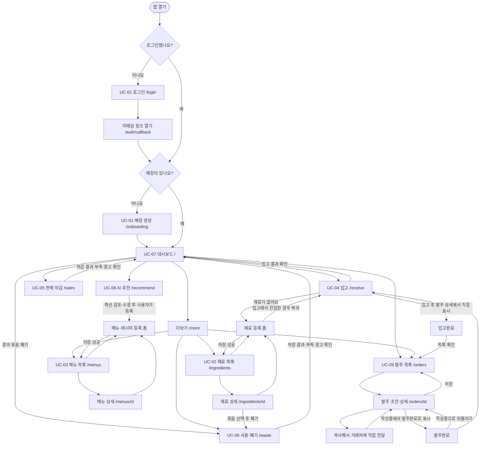
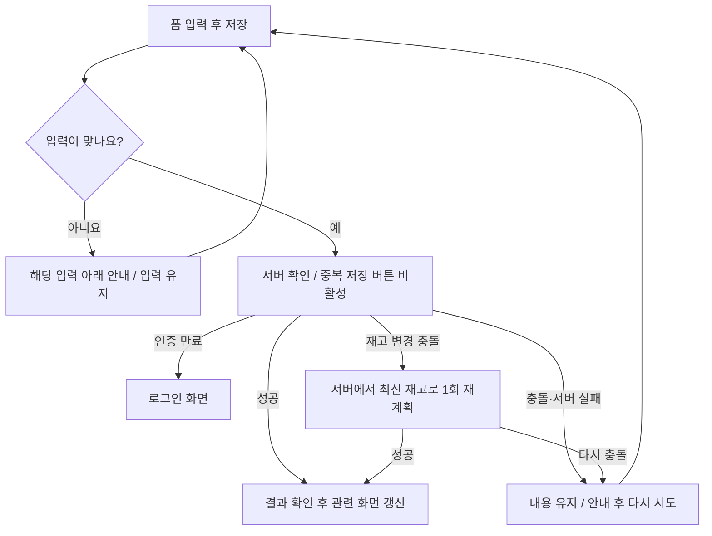

# 디자인 가이드

**시스템:** 재고콕
**버전:** v0.3 / 2026-11-03 (SRS v0.4 범위로 개정: 사용 기록·발주 목록 화면 추가, 바코드·라벨·PWA 삭제)
**기반:** Tailwind CSS + shadcn/ui, 모바일 우선

---

## 1. 디자인 원칙

| 원칙 | 의미 | 적용 예 |
|---|---|---|
| **한 손, 3초** | 주방에서 한 손으로, 3초 안에 핵심을 파악 | 주요 버튼은 화면 하단, 대시보드 첫 화면에 경고만 |
| **입력은 짧게** | 기본값을 채워 두고 사용자는 확인·수정만 | 입고일·사용일은 오늘, 단위는 재료 기본 단위, 발주량은 권장값 |
| **색은 상태에만** | 색을 장식이 아니라 기한·재고 상태를 알리는 데 사용 | 빨강=지남/D-1, 주황=D-2~3 |
| **쉬운 말** | IT 용어 대신 가게 말투 | "Lot" → "입고 묶음", "FEFO" → "먼저 쓸 것부터" |
| **실패해도 진행** | AI 실패 시 막다른 길 없음 | 추천 실패 시 규칙 기반 대체 결과, 재고 기능은 그대로 사용 |

## 2. 디자인 토큰

### 2.1 색상
shadcn/ui CSS 변수 체계를 따른다. 라이트·다크 모두 정의한다.

| 토큰 | 용도 | Light | Dark |
|---|---|---|---|
| `--primary` | 주요 버튼, 활성 탭 | `#16A34A` (green-600) | `#22C55E` |
| `--primary-foreground` | 주요 버튼 글자 | `#FFFFFF` | `#052E16` |
| `--background` | 화면 배경 | `#FFFFFF` | `#0A0A0A` |
| `--muted` | 카드 보조 배경 | `#F4F4F5` | `#18181B` |
| `--border` | 경계선 | `#E4E4E7` | `#27272A` |
| `--destructive` | 삭제, 폐기 | `#DC2626` | `#EF4444` |

**상태 색상 (기한·재고·추천 대조 전용)**

| 상태 | 조건 | 배지 색 | 텍스트 예 |
|---|---|---|---|
| `expired` | 기한 지남 (BR-05 경과) | 빨강 배경 `#FEE2E2` / 글자 `#B91C1C` | 지남 |
| `urgent` | D-0 ~ D-1 | 빨강 테두리 | D-1 |
| `soon` | D-2 ~ D-3 | 주황 `#FFEDD5` / `#C2410C` | D-3 |
| `ok` | D-4 이상 | 회색 | D-12 |
| `none` | 기한 추적 안 함 | 표시 없음 | - |
| `low` | 사용 가능 재고 < 최소 재고 (BR-05 부족) | 노랑 `#FEF9C3` / `#A16207` | 부족 |
| `rec-have` | 추천 재료 보유 | 회색 | 보유 |
| `rec-short` | 추천 사용량 > 사용 가능 재고 | 노랑 (`low`와 같음) | 재고 부족 |
| `rec-unregistered` | 매장에 없는 재료 | 회색 점선 테두리 | 등록되지 않은 재료 |

> 등록되지 않은 재료는 매장 단위를 알 수 없으므로 AI가 준 수량만 단위 없이 보여 준다 (예: "바질 30 · 등록되지 않은 재료"). 등록하려면 재료를 연결하거나 빼야 한다.

> 색만으로 구분하지 않는다. 항상 텍스트("D-1", "부족", "재고 부족")를 함께 표시한다.

### 2.2 타이포그래피
- 글꼴: **Pretendard** (CDN 또는 `next/font/local`), 대체 `system-ui`
- 숫자: `font-variant-numeric: tabular-nums` (수량·금액 정렬)

| 이름 | 크기/행간 | 굵기 | 용도 |
|---|---|---|---|
| `title` | 22/30 | 700 | 화면 제목 |
| `section` | 18/26 | 600 | 섹션 제목 |
| `body` | 16/24 | 400 | 본문, 입력값 (iOS 확대 방지를 위해 입력은 16 이상) |
| `caption` | 14/20 | 400 | 보조 정보 |
| `metric` | 28/34 | 700 | 대시보드 숫자 |

### 2.3 간격·모양
- 간격 단위 4px. 화면 좌우 여백 16px, 카드 내부 16px, 카드 간격 12px
- 모서리: 카드 12px, 버튼·입력 10px, 배지 999px
- **터치 영역 최소 44×44px**, 주요 버튼 높이 52px

## 3. 레이아웃

### 3.1 공통 구조
```text
┌──────────────────────────┐
│ 상단바: 화면 제목 · 보조 액션 │  56px
├──────────────────────────┤
│                          │
│        콘텐츠 영역          │  스크롤
│                          │
├──────────────────────────┤
│ [주요 버튼] (필요한 화면만)   │  고정, 52px + 안전 영역
├──────────────────────────┤
│ 🏠대시보드 📦입고 🧾마감 ✨추천 ☰더보기 │  하단 탭 64px
└──────────────────────────┘
```
- 하단 탭 5개: 대시보드 / 입고 / 마감 / 추천 / 더보기
- 더보기: 재료, 메뉴, 사용·폐기, 발주 목록, 설정(로그아웃)
- 발주 목록은 대시보드 바로가기로도 들어간다 (FR-DASH-04).
- 태블릿·PC(≥768px)에서는 하단 탭을 좌측 사이드바로 바꾸고 콘텐츠 최대 폭 720px

### 3.2 반응형 기준
| 구간 | 폭 | 레이아웃 |
|---|---|---|
| 모바일 | < 768px | 하단 탭, 1열 |
| 태블릿 이상 | ≥ 768px | 사이드바, 콘텐츠 중앙 정렬 |

### 3.3 화면 목록

| 화면 | 경로 | 요구사항 | 담당 (`04_WBS.md`) |
|---|---|---|---|
| 로그인·매장 생성 | `/login`, `/onboarding` | FR-AUTH-01~02 | 2.4 |
| 대시보드 | `/` | FR-DASH-01~04 | 4.1a |
| 입고 | `/receive` | FR-STK-01~04 | 3.3a |
| 판매 마감 | `/sales` | FR-USE-01·05 | 3.6a |
| AI 추천 | `/recommend` | FR-REC-02~07 | 4.2a·4.2b |
| 재료 목록·상세·등록 | `/ingredients`, `/ingredients/[id]` | FR-ING-01~03 | 3.1a |
| 메뉴·레시피 | `/menus`, `/menus/[id]` | FR-MENU-01~02 | 3.2a |
| 사용·폐기 기록 | `/waste` | FR-USE-03~05 | 3.7a |
| 발주 목록 | `/orders`, `/orders/[id]` | FR-ORD-01~05 | 4.3a |
| (확장) 명세서 확인 | `/receive/receipt/[id]` | FR-RCP-01~03 | 4.7 |

### 3.4 화면 흐름도 (WBS 2.8)

> 작성: 성윤우 · SRS v0.4의 UC-01~09 필수 흐름 기준. 화면의 구현 완료를 뜻하지 않는다. 와이어프레임과 토큰은 2장·4장을 그대로 사용한다.



[확대해서 보기 (HTML)](diagrams/screen-flows.html#screen-navigation) · [SVG 원본](diagrams/screen-navigation.svg)

<details>
<summary>Mermaid 원본</summary>



</details>

- 하단 탭(대시보드·입고·마감·추천·더보기)은 모든 로그인 후 화면에서 유지한다. 상세는 상위 목록으로 돌아가는 링크를 제공한다.
- 그림의 `/id`는 실제 동적 경로 `[id]`를 뜻한다. 등록·수정 폼은 목록/상세의 폼 또는 별도 하위 화면으로 구현하며 API 계약을 추가하지 않는다.
- 입고에서 새 재료를 등록하면 입고 입력을 유지한 채 돌아와 선택한다. 복귀 경로를 쓸 경우 같은 서비스의 허용된 경로만 사용한다.
- 발주 텍스트 복사는 사용자가 직접 전달하는 행동이다. 시스템이 메시지를 보내거나 발주 상태를 자동 변경하지 않는다. 필수 범위의 입고완료 표시도 사용자가 직접 한다.

### 3.5 유스케이스 ↔ 화면·행동 추적표

| 유스케이스 | 시작 화면·진입 | 확인·입력 화면 | 성공 후 | 요구사항 |
|---|---|---|---|---|
| UC-01 로그인·매장 생성 | 미로그인 접근 → `/login` | 이메일 링크·`/onboarding` | 매장 생성 후 `/` | FR-AUTH-01~03 |
| UC-02 재료 관리 | `/more` → `/ingredients` | 이름 검색·상태 필터, 상세 묶음, 등록·수정·비활성화 | 목록/상세 갱신, 입고에서 왔으면 입고로 복귀 | FR-ING-01~03·05 |
| UC-03 메뉴·레시피 관리 | `/more` → `/menus` | 메뉴 이름·가격·재료별 1인분 소요량, 상세 | 메뉴 목록/상세 갱신 | FR-MENU-01~02 |
| UC-04 식재료 입고 | 탭 `/receive` | 다품목·입고일·단위·금액·기한, 기한 계산 근거 확인 | 입고 결과 → 대시보드 | FR-STK-01~04, BR-01·03 |
| UC-05 판매 마감 | 탭 `/sales` | 날짜·메뉴별 판매량, 차감 결과·부족 경고 | 대시보드 재고 갱신 | FR-USE-01~02·05, BR-02 |
| UC-06 사용·폐기 | `/more` → `/waste` 또는 상세·대시보드에서 묶음 폐기 | 사용일·재료·수량·메모 / 지정 묶음·폐기량·사유 | 결과·기록 확인 → 대시보드 | FR-USE-03~05, FR-DASH-02 |
| UC-07 임박·부족 확인 | 로그인 후 `/` | 임박·경과 분리, 부족 재료, 재료 목록 상태 필터 | 폐기·추천·발주로 이동, 조회만으로 변경 없음 | FR-DASH-01~04, FR-ING-03, BR-05 |
| UC-08 AI 추천 | 탭 또는 대시보드 → `/recommend` | 기준 선택, 보유/부족/미등록, 기존 메뉴·특선 | 추천 저장·조회, 특선은 검토·수정·명시적 등록 | FR-REC-01~08, BR-04 |
| UC-09 발주 목록 | `/more` 또는 대시보드 → `/orders` | 초안 수량·추가·저장·복사, 상태 전이 | 작성중 ↔ 발주완료 → 입고완료 | FR-ORD-01~05, BR-06 |

### 3.6 빈 화면·실패·되돌아가기



[확대해서 보기 (HTML)](diagrams/screen-flows.html#screen-errors) · [SVG 원본](diagrams/screen-errors.svg)

<details>
<summary>Mermaid 원본</summary>



</details>

| 화면·상태 | 표시·복구 행동 |
|---|---|
| 재료 0개 | "아직 재료가 없어요" + 재료 등록. 조회 실패를 빈 재료로 표시하지 않음 |
| 재료 검색·필터 결과 0개 | "조건에 맞는 재료가 없어요" + 검색·필터 초기화 |
| 재료 비활성화 | 전체 잔량(경과 포함)이 남으면 "남은 재고를 먼저 사용·폐기해 주세요". 잔량이 없을 때 확인 후 요청 |
| 재료 상세 | 묶음별 입고일·기한·잔량·단가, 기한 추적 제외는 "기한 추적 안 함". 경과 묶음은 사용 대신 폐기 |
| 판매 마감 | 이미 마감한 날짜는 "이미 마감한 날짜예요". 재입력 확장은 구현 전까지 숨김 |
| 사용·폐기 | 사용은 가능한 재고만 차감하고 부족분 경고. 폐기는 지정 묶음 잔량 초과를 저장하지 않음 |
| AI 실패 | 서버의 규칙 기반 결과 + "규칙 기반" 표시. 대체 메뉴도 없으면 안내·재시도·재료/메뉴 관리 이동 제공 |
| AI 특선 등록 | 미등록 재료를 연결하거나 빼고 검토한 뒤 등록. 추천 조회만으로 메뉴·재고 변경 없음 |
| 발주 초안 0품목 | "부족한 재료가 없어요" + 직접 품목 추가 |
| 발주 상태·복사 | 작성중만 수정·삭제. 발주완료는 작성중으로 되돌린 뒤 수정. 입고완료는 수정 불가. 복사 권한 실패 시 텍스트를 직접 선택·복사 |

유통기한 화면에는 "매장 기준 권장 기한이에요"를 한 번 이상 표시한다. 상태는 색·텍스트·날짜를 함께 쓰며, 375×812에서 44px 터치 영역과 키보드·스크린리더 이름을 확인한다.

UC-01~09에 포함된 P1·P2 확장(판매 재입력, 실사 보정, 원가·폐기 금액, 발주→입고 불러오기, AI 보관일수)과 UC-10·11은 해당 확장 작업 착수 전까지 필수 화면에 노출하지 않는다. 기존 4장 와이어프레임은 각 화면 상세의 기준이다.

## 4. 화면 설계

### 4.1 대시보드 `/`
```text
┌──────────────────────────┐
│ 오늘 11/03 (화)  테스트 한식당 │
├──────────────────────────┤
│ ⛔ 기한 지난 재료  1          │
│ 우유  1L  [지남]  [폐기 처리] │
│ 기한이 지난 재료는 쓰지 말고    │
│ 폐기 처리해 주세요             │
├──────────────────────────┤
│ ⚠ 먼저 써야 할 재료  3      │
│ ┌──────────────────────┐ │
│ │ 두부   6모   [D-1]    │ │
│ │ 대파   1단   [D-2]    │ │
│ │ 계란   20구  [D-3]    │ │
│ └──────────────────────┘ │
│ [✨ 이 재료로 메뉴 추천받기]  │
├──────────────────────────┤
│ 부족한 재료  2   [발주 목록 →] │
│ 양파 1.2kg / 최소 3kg [부족] │
├──────────────────────────┤
│ (확장) 이번 주 폐기 12,400원  │
└──────────────────────────┘
```
- 기한 지난 묶음은 임박 목록과 따로, 맨 위에 보여 준다 (FR-DASH-02).
- 부족 판정은 사용 가능 재고(기한 지난 묶음 제외) 기준이다 (BR-05).

### 4.2 입고 `/receive`
```text
┌──────────────────────────┐
│ 입고        입고일 11/03 ▾  │
├──────────────────────────┤
│ [재료 검색 ▾]               │
│ 양파   [10] [kg ▾] 금액[15,000]│
│        유통기한 비우면 11/17   │
│        (입고일 + 기본 14일)    │
├──────────────────────────┤
│ 대파   [ 2] [단 ▾] 금액[ 6,000]│
│        1단 = 1000g          │
├──────────────────────────┤
│ [+ 품목 추가]                │
│ (확장) [📄 명세서 사진으로]    │
├──────────────────────────┤
│ [ 2품목 입고하기 ]           │
└──────────────────────────┘
```
- 단위 선택지는 기본 단위, kg/L(해당 시), 재료에 등록한 환산 단위(단·박스 등). 환산 계수가 없는 단위는 "환산 계수를 입력해 주세요"를 행 아래에 표시한다.
- 금액은 품목 총액(원). 서버가 기본 단위당 단가로 바꿔 저장한다.
- 저장 후 결과 시트: 묶음별 유통기한과 근거("입고일 + 기본 보관일수 14일") (FR-STK-02).

### 4.3 판매 마감 `/sales`
```text
┌──────────────────────────┐
│ 판매 마감   ◀ 11/03 (화) ▶  │
├──────────────────────────┤
│ 김치찌개      [ - ] 23 [ + ] │
│ 된장찌개      [ - ] 17 [ + ] │
│ 순두부찌개    [ - ]  9 [ + ] │
│ ...                       │
├──────────────────────────┤
│ [ 마감 저장 ]               │
└──────────────────────────┘
```
- 메뉴는 최근 7일 판매량 순으로 정렬
- 저장 후 부족 재료가 있으면 결과 시트: "양파가 300g 부족했어요. 재고를 확인해 주세요"
- 이미 마감한 날짜(재입력 기능 FR-USE-06 전): "이미 마감한 날짜예요"

### 4.4 사용·폐기 기록 `/waste`
```text
┌──────────────────────────┐
│ 사용·폐기   [사용] [폐기]    │
├──────────────────────────┤
│ 사용 (직원 식사, 시식 등)     │
│ 사용일 11/03 ▾              │
│ [재료 검색 ▾]  [300] g      │
│ 메모 [직원 식사          ]   │
│ [+ 품목 추가]                │
│ [ 사용 기록 저장 ]            │
└──────────────────────────┘
┌──────────────────────────┐
│ 폐기 — 우유                 │
├──────────────────────────┤
│ 묶음 선택                    │
│ ◉ 11/01 입고 · 1L · [지남]   │
│ ○ 11/02 입고 · 2L · [D-2]   │
│ 수량 [1] L                  │
│ 사유 (기한 경과)(변질)(실수)(기타)│
│ [ 폐기 기록 ]                │
└──────────────────────────┘
```
- 사용은 기한 빠른 것부터 자동 차감(BR-02), 폐기는 묶음을 직접 고른다 (FR-USE-04).
- 대시보드·재료 상세의 [폐기 처리]는 해당 묶음이 선택된 폐기 화면으로 연다.

### 4.5 AI 추천 `/recommend`
```text
┌──────────────────────────┐
│ 오늘의 추천        [다시 추천] │
│ 기준 (유통기한)(원가)(인기)    │
├──────────────────────────┤
│ [AI 추천] 재고 대조 결과를 확인하세요│
│ 🔥 오늘 많이 팔면 좋은 메뉴    │
│ ┌──────────────────────┐ │
│ │ 순두부찌개               │ │
│ │ 두부 6모 [보유] · D-1 재료 │ │
│ │ "두부가 내일까지예요"      │ │
│ └──────────────────────┘ │
│ 💡 새 특선 아이디어           │
│ ┌──────────────────────┐ │
│ │ 두부 크림 리조또           │ │
│ │ 두부 2모 [보유]           │ │
│ │ 우유 400ml [재고 부족]     │ │
│ │ 바질 5g [등록되지 않은 재료]│ │
│ │ 예상 원가 3,200원          │ │
│ │ [조리 순서 보기] [수정해서 등록]│ │
│ └──────────────────────┘ │
└──────────────────────────┘
```
- 기준 기본값은 유통기한 우선 (FR-REC-06). 보유 수량은 DB 값이다.
- [수정해서 등록]은 이름·판매가·재료·사용량을 고치는 시트를 연다. 등록되지 않은 재료가 남아 있으면 등록할 수 없다 (FR-REC-07).
- AI 실패 시: "추천을 만들지 못했어요. 임박 재료가 들어간 메뉴를 보여 드릴게요" + 규칙 기반 메뉴 목록(새 특선 없음).

### 4.6 발주 목록 `/orders`
```text
┌──────────────────────────┐
│ 발주 목록      [+ 새 목록]   │
├──────────────────────────┤
│ 11/03 작성중  3품목          │
│ 11/01 발주완료 5품목         │
│ 10/29 입고완료 4품목         │
└──────────────────────────┘
┌──────────────────────────┐
│ ← 11/03 발주   [작성중]     │
├──────────────────────────┤
│ 양파  권장 7kg   [7000] g   │
│   사용 가능 1.2kg · 적정 10kg │
│   발주했지만 아직 안 온 양 1.8kg│
│ 대파  권장 3단   [3000] g   │
│ [+ 품목 추가]                │
├──────────────────────────┤
│ [저장] [복사] [발주완료로 표시] │
└──────────────────────────┘
```
- 새 목록은 권장 발주량(BR-06)으로 채운 초안이다. 부족 재료가 없으면 "부족한 재료가 없어요" + 직접 추가.
- [복사] 텍스트 예: "양파 7kg / 대파 3kg" — 1000g 이상은 kg로 표시 (FR-ORD-04).
- 상태: 작성중 ↔ 발주완료 → 입고완료. 수정·삭제는 작성중에서만. 입고완료는 사용자가 직접 표시한다(부분 입고 포함).

### 4.7 기타 화면
| 화면 | 핵심 구성 |
|---|---|
| 재료 목록 | 검색, 필터 칩(냉장/냉동/실온/임박/지남/부족), 행: 이름·사용 가능 재고·가장 빠른 기한 배지 (FR-ING-03) |
| 재료 상세 | 기본 정보, 입고 묶음 목록(유통기한 순), 묶음별 [폐기] (확장: [수량 보정]) |
| 재료 등록·수정 | 이름, 카테고리, 기본 단위, 최소 재고, 적정 재고(선택, 최소 재고 이상), 보관 방식("냉장 (0~10℃)", "냉동 (-18℃ 이하)", "실온 (1~35℃)"), 기본 보관일수, 유통기한 추적(소금·설탕 등은 끔), 환산 단위 목록(예: 1단 = 1000g). (확장) 이름 입력 시 AI 추천값 + "AI 추천" 배지 |
| 메뉴 상세 | 판매가, 레시피 재료·1인분 소요량 (확장: 원가·원가율) |

## 5. 컴포넌트

| 컴포넌트 | 기반 (shadcn/ui) | 설명 |
|---|---|---|
| `ExpiryBadge` | Badge | `daysLeft`를 받아 상태 색·텍스트 표시 |
| `StockBadge` | Badge | 부족 여부 표시 |
| `RecStatusBadge` | Badge | 추천 재료 보유 / 재고 부족 / 등록되지 않은 재료 |
| `QuantityStepper` | Button + Input | −/+ 버튼, 숫자 직접 입력 |
| `UnitSelect` | Select | 기본 단위 + kg/L + 재료별 환산 단위 |
| `IngredientPicker` | Command + Sheet | 재료 검색·선택, "새 재료로 등록" 항목 |
| `LineItemRow` | Card | 입고·사용·발주의 한 줄 편집 행 |
| `EditSheet` | Sheet (bottom) | 행 편집 공용 하단 시트 |
| `RecommendationCard` | Card | 추천 카드 |
| `OrderStatusBadge` | Badge | 작성중 / 발주완료 / 입고완료 |
| `EmptyState` | - | 아이콘 + 설명 + 행동 버튼 |
| `AiBadge` | Badge | "AI 추천" 표시 |
| (확장) `ImageCapture` | Input(file, capture) | 명세서 촬영 + 압축 |

## 6. 상태 표현

| 상태 | 표현 |
|---|---|
| 로딩 (일반) | 스켈레톤 |
| AI 처리 중 | 진행 문구 순환: "재고를 확인하고 있어요" → "메뉴를 고르고 있어요" (최대 15초, NFR-06) |
| 빈 상태 | 대시보드: "아직 재료가 없어요. 첫 입고를 해볼까요?" + [입고하기] |
| 오류 | 토스트 + 다음 행동 제시: "저장하지 못했어요. [다시 시도]" |
| 성공 | 토스트 "8품목을 입고했어요" + 진동(지원 시) |
| AI 실패 | 규칙 기반 대체 결과 + "추천을 만들지 못했어요. 임박 재료가 들어간 메뉴를 보여 드릴게요" |

## 7. 문구 가이드

| 하지 말 것 | 이렇게 |
|---|---|
| Lot | 입고 묶음 |
| FEFO 차감 | 기한 빠른 것부터 차감 |
| 유효성 검사 실패 | 수량을 다시 확인해 주세요 |
| 환산 계수 없음 | 환산 계수를 입력해 주세요 |
| 재고 부족 오류 | 양파가 300g 부족했어요. 재고를 확인해 주세요 |
| expired | 기한이 지난 재료는 쓰지 말고 폐기 처리해 주세요 |
| AI 오류 / 파싱 실패 | 추천을 만들지 못했어요. 임박 재료가 들어간 메뉴를 보여 드릴게요 |
| unregistered | 등록되지 않은 재료 |
| short | 재고 부족 |
| CONFLICT (상태) | 발주완료된 목록은 고칠 수 없어요. 작성중으로 되돌린 뒤 고쳐 주세요 |
| CONFLICT (마감) | 이미 마감한 날짜예요 |
| RATE_LIMITED | 오늘 추천 횟수를 다 썼어요. 내일 다시 시도해 주세요 |
| 레코드가 없습니다 | 아직 기록이 없어요 |

- 존댓말, "~해요" 체로 통일
- 기한 관련 화면에 한 번은 "매장 기준 권장 기한이에요" 안내
- AI 결과에는 항상 "AI 추천" 배지와 "재고 대조 결과를 확인하세요" 안내 (FR-REC-05)

## 8. 접근성
- 텍스트 대비 4.5:1 이상 (상태 배지 포함)
- 아이콘 단독 버튼에는 `aria-label`
- 상태는 색 + 텍스트로 함께 전달
- 폼 오류는 입력란 아래 텍스트 + `aria-invalid`
- 시스템 글자 크기 확대 시 레이아웃이 깨지지 않게 고정 높이 지양

## 9. 아이콘
- 아이콘: `lucide-react` (shadcn 기본)
- 재료 카테고리 아이콘: 채소 `Carrot`, 육류 `Beef`, 수산 `Fish`, 유제품 `Milk`, 양념 `Soup`, 기타 `Package`
