# 데이터베이스 (스키마·샘플 데이터) — 재고콕

> 융합SW모델설계 PBL ⑧ 최종 산출물 · 팀 재고콕 (김형균·임지섭·성윤우)
> DBMS: Supabase(PostgreSQL) · 전체 SQL: `supabase/migrations/0000~0013`, 샘플 데이터: `supabase/seed.sql`, 상세 설계: `docs/07_DB.md`

## 1. 설계 원칙

| 원칙 | 내용 |
|---|---|
| 재고는 입고 묶음 단위 | 재료 총량이 아니라 입고 묶음(`stock_lots`)마다 수량·잔량·유통기한을 둔다. 재고 = 묶음 잔량의 합. 기한 추적과 "기한 빠른 묶음부터 차감(FEFO)"을 위해서다 |
| 이력은 추가만 | `stock_movements`는 지우거나 고치지 않는다. 되돌리기는 반대 방향 `adjust` 이력으로 남긴다 |
| 변경은 RPC로만 | 재고·판매·AI 사용 횟수는 DB 함수(RPC) 하나가 한 트랜잭션으로 바꾼다 (잠금 → 재검증 → 반영 → 이력). 테이블 직접 쓰기는 권한으로 막았다 (0008·0009) |
| 매장 단위 격리 | 모든 테이블에 RLS. 사용자는 자기 매장 데이터만 보고 바꾼다 |
| 오늘 날짜는 앱이 전달 | DB에서 `current_date`로 오늘을 구하지 않고 서버가 KST 기준 날짜를 인자로 넘긴다 |

## 2. ERD



- 매장(`stores`) 1개가 재료·메뉴·묶음·판매·발주·추천 기록을 모두 가진다.
- 재료 1 : N 입고 묶음 1 : N 재고 이력. 메뉴 N : M 재료(`recipe_items`, 1인분 소요량).
- 판매는 두 경로다: 하루치 판매 마감(`sales_days` → `sales`)과 주문별 판매(`sale_orders`, 확장 4.8).
- ERD 그림은 11/03 설계 기준이며, 이후 추가된 `sale_orders`는 아래 3장 표에 있다.

## 3. 테이블

| 테이블 | 설명 | 주요 제약 | 관련 요구사항 |
|---|---|---|---|
| `stores` | 매장 (사용자당 1개) | `owner_id` 유일 | FR-AUTH-02~03 |
| `ingredients` | 재료 (기본 단위 g·ml·ea, 기본 보관일수, 최소·적정 재고) | `(store_id, name)` 유일, 적정 ≥ 최소 | FR-ING-01 |
| `ingredient_units` | 재료별 환산 단위 (단·박스·판 → 기본 단위) | PK `(ingredient_id, unit_name)`, 계수 > 0 | FR-ING-05, BR-03 |
| `stock_lots` | 입고 묶음 (재고의 실체) | `0 ≤ remaining ≤ quantity` | FR-STK-01~04 |
| `stock_movements` | 재고 이력 (추가 전용) | `delta ≠ 0` | 데이터 규칙 |
| `menus` | 메뉴 (판매가, 판매 중 여부, AI 특선 여부) | `(store_id, name)` 유일 | FR-MENU-01 |
| `recipe_items` | 메뉴별 재료 1인분 소요량 | PK `(menu_id, ingredient_id)` | FR-MENU-02 |
| `sales_days` | 날짜별 판매 마감과 부족 기록 | `(store_id, sold_on)` 유일 | FR-USE-01·05 |
| `sales` | 마감의 메뉴별 판매 수량 | `(sales_day_id, menu_id)` 유일 | FR-USE-01 |
| `sale_orders` | 주문별 판매 (사이트 `/sell`·포스 연동), 취소 시각 | `(store_id, source, external_id)` 유일 — 같은 주문 재전송은 한 번만 반영 | 확장 4.8 |
| `usage_records` | 메뉴와 무관한 직접 사용·부족 기록 | `qty > 0` | FR-USE-03·05 |
| `purchase_orders` | 발주 목록 | 상태 작성중 → 발주완료 → 입고완료 | FR-ORD-01~05 |
| `purchase_order_items` | 발주 품목 | PK `(order_id, ingredient_id)`, `qty > 0` | FR-ORD-01~02 |
| `recommendations` | AI 추천의 입력 스냅샷·결과·검증 기록 | 기준(`basis`) 3종 | FR-REC-06·08 |
| `ai_usage` | 매장별 AI 하루 호출 수 | PK `(store_id, used_on)` | NFR-12 |

- 수량은 `numeric(12,3)`(소수 셋째 자리), 기본 단위당 단가는 `numeric(12,4)`다.
- **사용 가능 재고** = 기한이 지나지 않은 묶음의 잔량 합. 조회 함수 `get_ingredient_stock(store, today)`가 재료별 총잔량·사용 가능량·부족 여부를 계산한다.

## 4. 보안 (RLS·권한)

| 대상 | 정책 |
|---|---|
| 모든 테이블 | RLS 사용. `is_my_store(store_id)`(로그인 사용자가 매장 주인인지)로 조회 범위를 자기 매장으로 제한 |
| 재고 (`stock_lots`·`stock_movements`) | 조회만 허용, 쓰기는 RPC로만 (`0008`) |
| 판매·AI 사용 (`sales_days`·`sales`·`sale_orders`·`ai_usage`) | 조회만 허용, 쓰기는 RPC로만 (`0009`) — 직접 삭제로 AI 한도를 우회하거나 같은 날짜를 두 번 차감하는 경로 차단 |
| RPC 실행 경로 | 변경 함수의 실행 모드·`search_path` 고정, `PUBLIC`의 보호 테이블 쓰기 회수, 익명(anon) 실행 회수 (`0010`) |
| 매장 | 직접 삭제 권한 회수 — 매장을 지우고 다시 만들어 AI 한도를 다시 얻는 경로 차단 (`0013`) |
| 내부 함수 | 다른 RPC 안에서만 쓰는 `apply_consumption`은 `private` 스키마 (REST로 호출 불가, `0004`) |

서버는 화면이 보낸 매장 ID를 쓰지 않고 로그인 세션에서 매장을 구한다. 서비스 키(service role)는 쓰지 않는다.

## 5. RPC 함수

| 함수 | 용도 | 정의 (최종 변경) |
|---|---|---|
| `receive_stock` | 입고 — 여러 품목 묶음 생성 + 이력 | 0003 (0008) |
| `private.apply_consumption` | 묶음 차감 공통 — 묶음 잠금, 잔량·기한 재검증, 차감, 이력 | 0003 → 0004 |
| `record_daily_sales` | 판매 마감 — 판매 기록 + FEFO 차감. 같은 날짜 재입력은 묶음별 차이만 반영 | 0003 (0007·0012) |
| `record_sale_order` / `cancel_sale_order` | 주문별 판매·취소 (같은 주문번호 재전송은 한 번만 차감) | 0005·0006 |
| `record_usage` | 직접 사용 | 0003 |
| `record_waste` | 폐기 (경과 묶음 포함) | 0003 |
| `save_order` | 발주 목록 저장 (품목 통째 교체) | 0003 |
| `adjust_lot` | 실사 보정 (확장 FR-USE-07) | 0003 (0008) |
| `increment_ai_usage` | AI 하루 호출 한도 확인·증가 | 0003 (0009) |
| `get_ingredient_stock` | 재료별 재고 요약 조회 | 0001 |
| `sales_qty_by_menu` | 최근 7일 메뉴별 판매량 합산 (추천 입력) | 0011 |

차감 계획(어떤 묶음에서 얼마)은 서버의 순수 함수(`lib/stock`)가 만들고, RPC는 묶음을 잠근 뒤 잔량이 바뀌었으면 `STOCK_CONFLICT`로 거부한다. 서버는 최신 재고로 한 번 다시 계획한다.

## 6. 마이그레이션 이력

| 파일 | 내용 |
|---|---|
| `0000_stores.sql` | 매장 테이블, `is_my_store`, 매장 RLS (로그인·매장 생성) |
| `0001_init.sql` | 타입·전체 테이블·인덱스·재고 요약 함수 |
| `0002_rls.sql` | 전체 테이블 RLS 정책 |
| `0003_rpc.sql` | 입고·차감·판매 마감·사용·폐기·발주 저장·AI 한도 RPC |
| `0004_private_consumption.sql` | 차감 공통 함수를 `private` 스키마로 (REST 직접 호출 차단) |
| `0005_sale_orders.sql` | 주문별 판매 테이블·RPC, 같은 날짜 판매 마감과 상호 배제 |
| `0006_cancel_sale_order.sql` | 주문 취소 — 같은 묶음에 되돌리고 반대 방향 이력 |
| `0007_sales_revision.sql` | 같은 날짜 판매 재입력 (확장 FR-USE-06) |
| `0008_stock_write_rpc_only.sql` | 재고 테이블 쓰기를 RPC로만 |
| `0009_rpc_only_sales_ai.sql` | 판매 기록·AI 사용 횟수 쓰기를 RPC로만 |
| `0010_rpc_search_path_hardening.sql` | RPC 실행 경로 강화 (보안 QA 후속) |
| `0011_sales_qty_by_menu.sql` | 7일 판매량 DB 합산 (주문 1000건 넘으면 잘리던 문제) |
| `0012_sales_revision_net.sql` | 판매 재입력·주문 취소 되돌림을 묶음별 차이만큼으로, 마감·주문 동시 처리 잠금 |
| `0013_store_no_delete.sql` | 매장 직접 삭제 권한 회수 |

## 7. 샘플 데이터 (`supabase/seed.sql`)

실제 매장·개인 데이터는 쓰지 않은 가상 데이터다.

| 항목 | 내용 |
|---|---|
| 매장 | 테스트 사용자 1명, 매장 1개 ("테스트 한식당") |
| 재료 | 30종 (채소 10, 육류 5, 수산 4, 유제품·계란 4, 양념 5, 곡류 1, 기타 1). 기한 추적 제외 2종(소금·설탕), 환산 단위 3개(대파 "단", 계란 "판", 두부 "모") |
| 메뉴 | 15개와 1인분 레시피 |
| 재고 | 최근 14일 입고 묶음 — 일부는 D-0~D-3 임박, 일부는 기한 경과 |
| 기록 | 최근 14일 판매 마감과 차감 이력, 직접 사용 3건, 폐기 3건 |
| 부족 | 사용 가능 재고가 최소 재고 미만인 재료 3종 이상 |
| 발주 | 발주 목록 2개 (작성중 1, 발주완료 1) |

- 날짜는 기준일 2026-11-03으로 쓰고, 실행할 때 KST 오늘과의 차이만큼 옮겨 늘 같은 데모 상태가 된다.
- 검산 결과: `docs/seed-review.md`.
- 알려진 문제: 시드의 데모 계정으로는 로그인이 되지 않는다 (GitHub 이슈 #92, 로그인 토큰 칼럼이 비어 있음). 시연은 실제로 가입한 계정에 데이터를 넣어 한다.

## 8. 재현 방법

```bash
pnpm install
pnpm exec supabase start        # 로컬 Supabase (Docker 필요)
pnpm exec supabase db reset     # 마이그레이션 0000~0013 + 시드 적용
pnpm exec supabase gen types typescript --local > src/types/database.ts
pnpm test                       # DB 테스트 포함 (로컬 Supabase가 있으면 실행)
```
